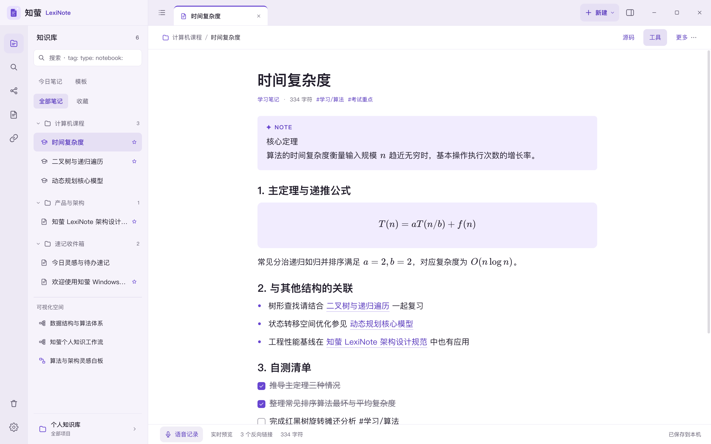
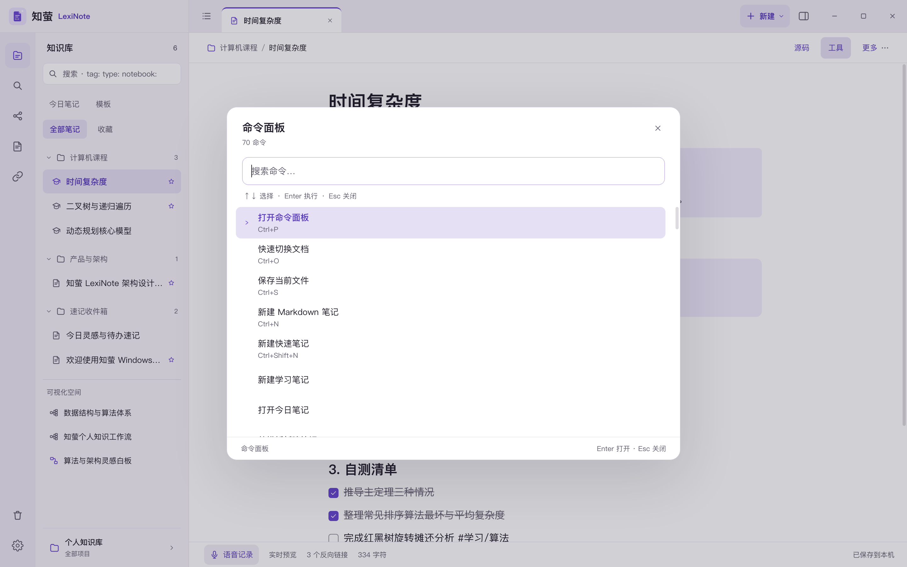

# 知萤 LexiNote · Windows 版

## 分支选择

当前为 **Windows** 分支，应用项目位于仓库根目录。

- [HarmonyOS：鸿蒙工程](https://github.com/peryixing-lab/LexiNote/tree/HarmonyOS)
- [Windows：Windows 工程](https://github.com/peryixing-lab/LexiNote/tree/Windows)
- [macOS：macOS 原生工程](https://github.com/peryixing-lab/LexiNote/tree/macOS)
- [main：项目概览、Harness 插件和共享文档](https://github.com/peryixing-lab/LexiNote/tree/main)

克隆当前平台：

```sh
git clone --branch Windows --single-branch https://github.com/peryixing-lab/LexiNote.git
cd LexiNote
```


知萤 LexiNote 的 Windows 桌面移植版本：本地优先的 Markdown 笔记、双向链接、关系图谱与思维导图。
界面按 HarmonyOS 工程的电脑端工作区重做，**不依赖鸿蒙运行时**，使用 Electron + React + TypeScript 构建，
同时提供 **ARM64**、**x86_64（x64）** 与 **x86 32 位（ia32）** 三种 Windows 构建。

> 原项目：[peryixing-lab/LexiNote](https://github.com/peryixing-lab/LexiNote)（GPL-3.0）。
> Windows、macOS 与 HarmonyOS 版本在本仓库统一维护和发布。

## 界面






更多截图见 [`docs/screenshots/`](docs/screenshots/)：深色主题、右侧栏、图谱、导图、白板、阅读/源码模式与英文界面。

桌面工作区沿用原工程的布局与视觉令牌：

- 左侧功能区（知识库、快速切换、命令面板、阅读切换、关系图谱、回收站、设置）
- 知识库侧栏（搜索语法、今日笔记、模板、全部笔记 / 收藏、文件夹树、可视化空间、工作区切换）
- 顶部标签栏（多标签、右键关闭、拖拽排序、新建菜单、右侧栏开关、窗口按钮）
- 编辑器（大标题、实时预览 / Markdown 源码 / 阅读视图、工具与更多菜单、查找替换、状态栏）
- 右侧栏（大纲、出链、反向链接、笔记属性）
- 命令面板、快速切换、设置窗口、关系图谱、思维导图、白板、文档管理、回收站、模板库、使用帮助

主题色算法、Markdown 块解析、双向链接、思维导图布局均从 ArkTS 源码逐项移植，保持与原版一致的行为。

### 材质替换（重要）

鸿蒙版的界面材质依赖 HDS / 系统能力，Windows 上不可用。按要求统一替换为普通材质：

| 鸿蒙材质 / 能力 | Windows 实现 |
| --- | --- |
| HDS 沉浸光感、液态玻璃、系统模糊 | 纯色与半透明普通材质；无 backdrop blur、无镜面反射 |
| 沉浸式窗口 / 安全区 | 普通无边框窗口 + 自绘标题栏与窗口按钮 |
| 系统分享剪藏、跨设备接续 | 本地导入 Markdown / 剪贴板；不联网、不跨设备 |
| 桌面服务卡片 | 暂未提供 |
| 离线语音识别 | 调用系统输入法语音输入（Win+H） |
| ArkWeb 插件运行时 | 实验性 iframe 插件宿主、ZIP 安装与逐项授权 |

## 功能

- **写作**：Markdown 标题、列表、任务清单、引用、标注（NOTE / TIP / WARNING…）、表格、代码块（语法高亮）、
  图片、嵌入、`$…$` 行内公式与 `$$…$$` 块级公式（KaTeX 离线排版）。
- **组织**：知识库、项目、文件夹、标签、收藏、置顶、全文搜索（`tag:` / `type:` / `notebook:` / `[属性]:` / `-排除`）。
- **连接**：`[[双向链接]]`（支持 `#标题` 定位）、出链与反向链接、未连接提及、关系图谱。
- **可视化**：思维导图（向右树 / 平衡图 / 组织结构，拖拽、折叠、颜色、转笔记、复制大纲）、白板卡片。
- **数据**：自动保存、JSON 完整备份与恢复、导出工作区 Markdown、导入 Markdown/JSON、回收站。
- **插件（实验性）**：从 ZIP 安装、逐项授权、iframe 隔离宿主，支持原生插件与部分 Obsidian API；已使用 Harness 1.5.0 执行兼容性测试。
- **外观**：浅色 / 深色 / 跟随系统；鸢尾紫、玫瑰粉、暖杏橙、森林绿、晴空蓝、石墨灰与自定义强调色；
  界面语言简体中文 / English；字号与缩放。
- **多标签**：标签页拖拽排序、右键菜单、中间键关闭、分屏标签组。
- **工作区与窗口**：从知识库切换器选择其他工作区时，询问「在当前窗口打开」还是「在新窗口打开」；
  可勾选「下次不再提示」。该开关是**全局偏好**，不按工作区保存；每个工作区的打开方式单独保存在
  工作区本身（设置 → 编辑器，可为每个工作区选择每次询问 / 当前窗口 / 新窗口）。
- **初始安装**：不包含任何示例笔记、导图、白板或项目，首次启动只有一份空的知识库；
  空状态直接提供「新建笔记」与「从模板新建」入口。测试与设计截图通过 `LEXI_DEMO_DATA=1`
  注入演示数据，不会随安装包分发。

## 架构

```text
src/
  main/          Electron 主进程：窗口、单实例、IPC、本地 JSON 存储、多窗口状态合并、导入导出、退出前落盘
  preload/       contextBridge 白名单 API（无 Node 暴露给页面）
  renderer/      React 界面
    core/        主题、Markdown 引擎、数学语法、搜索、i18n、初始状态与演示夹具
    store/       应用状态、持久化、命令分发
    components/  工作区、侧栏、编辑器、右栏、图谱、导图、白板与各类对话框
    styles.css   设计令牌与全部界面样式
  shared/        主进程与渲染进程共享的数据类型
scripts/         构建、截图、冒烟测试与 Windows 打包脚本
tests/           冒烟测试脚本（在真实 Electron 窗口中执行）
```

安全设置：`contextIsolation: true`、`nodeIntegration: false`、`sandbox: true`，页面 CSP 限制脚本与资源来源；
外部链接交给系统浏览器打开。

数据位置：`%APPDATA%\LexiNote\lexinote-data.json`（窗口尺寸在同目录 `window-state.json`）。
写入采用临时文件 + 原子重命名；退出前会请求渲染进程落盘。

## 系统要求

- Windows 10 1809 及以上 / Windows 11；x64、ARM64 与 32 位 x86 分别对应独立安装包。
- 约 400 MB 磁盘空间（安装后），内存建议 4 GB 以上。
- 安装包未签名，首次运行可能出现 SmartScreen 提示；正式分发请配置代码签名。

## 开发

需要 Node.js 20+（建议 22）与 npm。

```sh
npm ci
npm run build        # 主进程 + 渲染进程
npm start            # 构建后启动 Electron
npm run dev          # 可选：Vite 开发服务器 + Electron（需要手动启动 electron）
npm run typecheck
npm run smoke        # 真实窗口中的功能冒烟测试（macOS 下自动加 --no-sandbox）
node scripts/flush.mjs  # 退出前落盘回归：输入后立即关窗，校验数据文件
```

截图（用于设计验收）：

```sh
npm run shots        # 生成界面截图到 .dsh-shot（docs/screenshots 的来源）
# 或指定状态：
node scripts/screenshot.mjs workspace palette settings appearance dark mindmap graph library reading right
# 输出 .dsh-shot/*.png
```

截图覆盖中文/英文、浅色/深色、工作区、命令面板、设置、图谱、导图、白板、阅读与源码模式。

## 构建 Windows 安装包

### 在 Windows 上构建（推荐）

```powershell
npm ci
npm run build
npx electron-builder --win --x64 --arm64 --ia32 --publish never
```

产物在 `release/`：

- `LexiNote-Setup-2.0.1-x64.exe`：x86_64 安装包（NSIS，可选安装目录）
- `LexiNote-Setup-2.0.1-arm64.exe`：Windows on ARM 安装包
- `LexiNote-Setup-2.0.1-ia32.exe`：32 位 x86 安装包
- `LexiNote-2.0.1-windows-{x64,arm64,ia32}.zip`：免安装便携版（解压后运行 `LexiNote.exe`）

> ARM64 安装包使用 NSIS 生成，安装器本身是 32 位程序，在 Windows on ARM 上由系统模拟运行；
> 安装后的 `LexiNote.exe` 与 `resources` 中的 Electron 运行时均为原生 ARM64。

### 在 macOS / Linux 上交叉构建

electron-builder 可以在 macOS 上生成 Windows 的 NSIS 安装包与 zip；项目提供了隔离缓存的脚本：

```sh
npm run package:win            # x64 + arm64 + ia32
npm run package:win:x64
npm run package:win:arm64
npm run package:win:ia32
```

脚本会把 Electron 与 electron-builder 的下载缓存放在仓库内（`.electron-cache/`、`.eb-cache/`、
`.build-home/`），避免写入用户目录；打包完成后产物同样在 `release/`。

未签名安装包在 Windows 上会触发 SmartScreen 提示。正式分发请在 Windows 构建机上配置代码签名证书
（`CSC_LINK` / `CSC_KEY_PASSWORD`，或 electron-builder 的 `win.certificateFile`）。

## 快捷键

| 操作 | 快捷键 |
| --- | --- |
| 命令面板 | `Ctrl+P` |
| 快速切换文档 | `Ctrl+O` |
| 新建 Markdown 笔记 | `Ctrl+N` |
| 新建快速笔记 | `Ctrl+Shift+N` |
| 保存 | `Ctrl+S` |
| 切换编辑 / 阅读 | `Ctrl+E` |
| 查找 / 替换 | `Ctrl+F` / `Ctrl+H` |
| 加粗 / 斜体 | `Ctrl+B` / `Ctrl+I` |
| 关闭标签 | `Ctrl+W` |
| 上一个 / 下一个标签 | `Ctrl+Shift+Tab` / `Ctrl+Tab` |
| 显示 / 隐藏侧栏 | `Ctrl+\` |
| 缩放 | `Ctrl+=` / `Ctrl+-` / `Ctrl+0` |
| 设置 | `Ctrl+,` |
| 使用帮助 | `F1` |

## 已移植范围与已知差异

移植优先保证电脑端工作区与写作主链路可用：

- **已移植**：工作区布局、主题、Markdown 与公式、双向链接、搜索、图谱、思维导图、白板、
  命令面板、设置、回收站、模板、导入导出、备份恢复、中英文界面。
- **未移植**：插件市场、系统服务卡片、分享剪藏、跨设备接续、
  外部文件夹实时同步、PDF 直接导出（当前导出可打印的 HTML，可在浏览器中另存为 PDF）、
  拼写检查与多光标编辑。
- **多窗口**：已支持同一本地库的多个窗口；窗口标题会带上当前工作区名，便于在任务栏区分。
  保存时主进程按笔记 / 导图 / 白板的更新时间合并并广播。同一篇笔记在两个窗口同时编辑时采用
  最后保存者优先，建议不要在两个窗口同时改同一篇笔记。
- 原工程的 174 条命令中，桌面版保留与写作/组织相关的 70 条；未开放的命令会给出明确提示，
  不会静默失败。

## 实验性插件验证

从 [Release](https://github.com/peryixing-lab/LexiNote/releases/tag/v2.0.1) 下载 Harness 1.5.0 ZIP，或使用 main 分支的 `plugins/harness/` 自行构建。将 ZIP 放在本工程的 `tests/fixtures/harness-lexinote-harness.zip`，然后执行 `npm run test:plugins`；也可通过环境变量 `LEXINOTE_HARNESS_ZIP` 指定 ZIP 的绝对路径。测试只使用本地夹具，不调用真实模型服务。

## 测试

- `npm run smoke`：在真实 Electron 窗口中执行冒烟测试，覆盖笔记切换、块编辑、自动保存、
  新建笔记、搜索、命令面板、右侧栏与图谱渲染。
- `node scripts/flush.mjs`：输入后立刻关闭窗口，验证主进程在退出前请求渲染进程落盘。
- `npm run empty`：以全新数据目录启动，验证初始安装不含笔记、导图、白板或项目，只保留一个空工作区。
- 冒烟测试还覆盖：工作区打开询问、在当前窗口打开、在新窗口打开、全局「下次不再提示」、
  每个工作区单独设置打开方式，以及多窗口按请求的工作区启动。
- `npm run typecheck`：渲染进程与主进程 TypeScript 严格检查。
- 本仓库在 macOS 上完成交叉构建，Electron 渲染层的冒烟与退出落盘测试在 macOS 上执行；
  安装包已完成 PE 架构、图标、版本信息与 asar 打包校验。建议在 Windows 真机上再执行一次
  `npm run smoke` 或手动走查（尤其 32 位 ia32 版本）。
- 设计验收截图见 `docs/screenshots/`（`npm run shots` 可重新生成）。

## 2.0.1 验证记录

- TypeScript 严格检查和生产构建通过。
- 已在 macOS 上使用隔离数据目录运行 Electron 冒烟、插件兼容性、退出前落盘和全新安装检查。
- x64、ARM64 与 ia32 的 NSIS 安装包及便携 ZIP 已重新构建为 2.0.1。
- 已核对三个架构的 PE 类型、app.asar 内版本号，以及打包内容中不含测试目录、日志或用户数据。
- Windows 原生安装和设备相关行为仍需在目标设备上验证，尤其是 32 位 ia32 版本。

## 许可

本项目沿用上游 **GNU General Public License v3.0**，见 [LICENSE](LICENSE)。界面图标与品牌资源来自
上游 LexiNote 工程；第三方依赖许可见 [THIRD_PARTY_NOTICES.md](THIRD_PARTY_NOTICES.md)。
