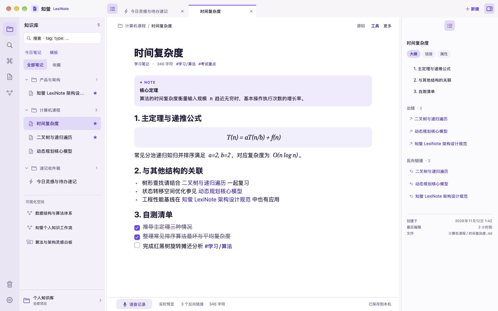
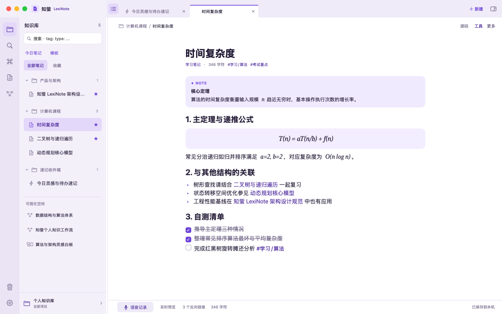
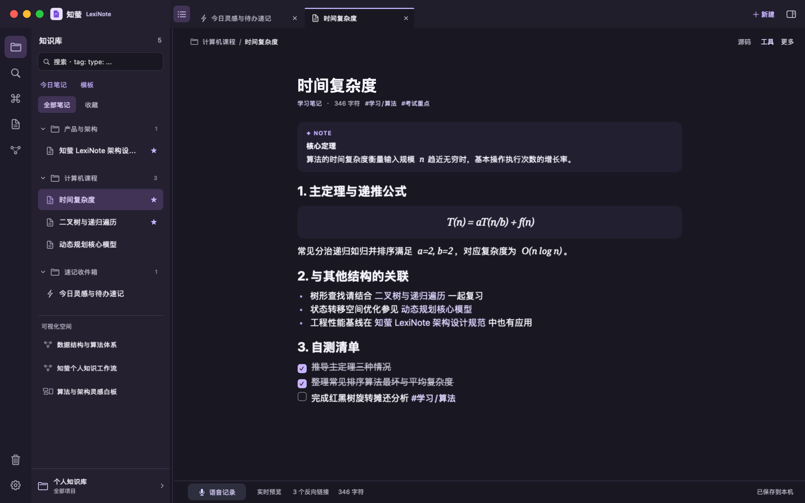
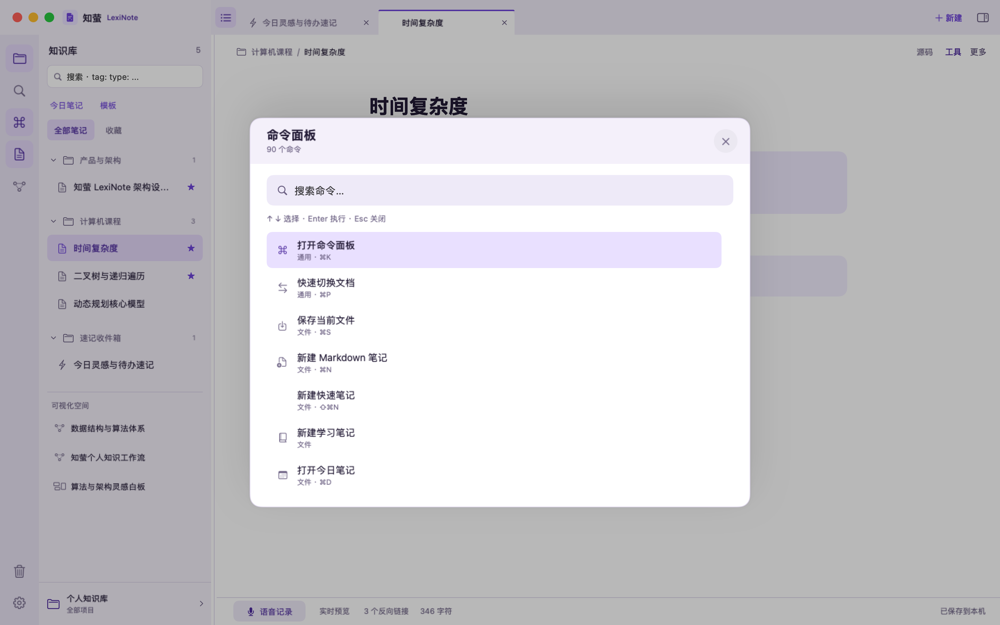
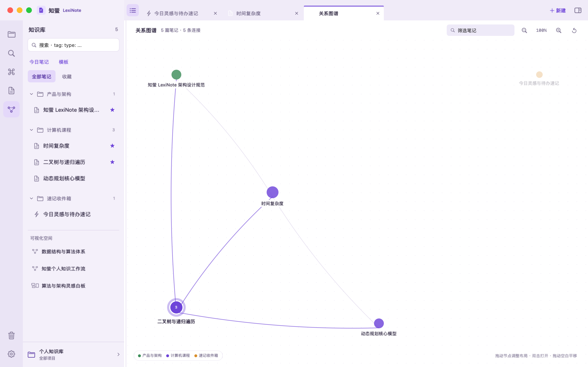
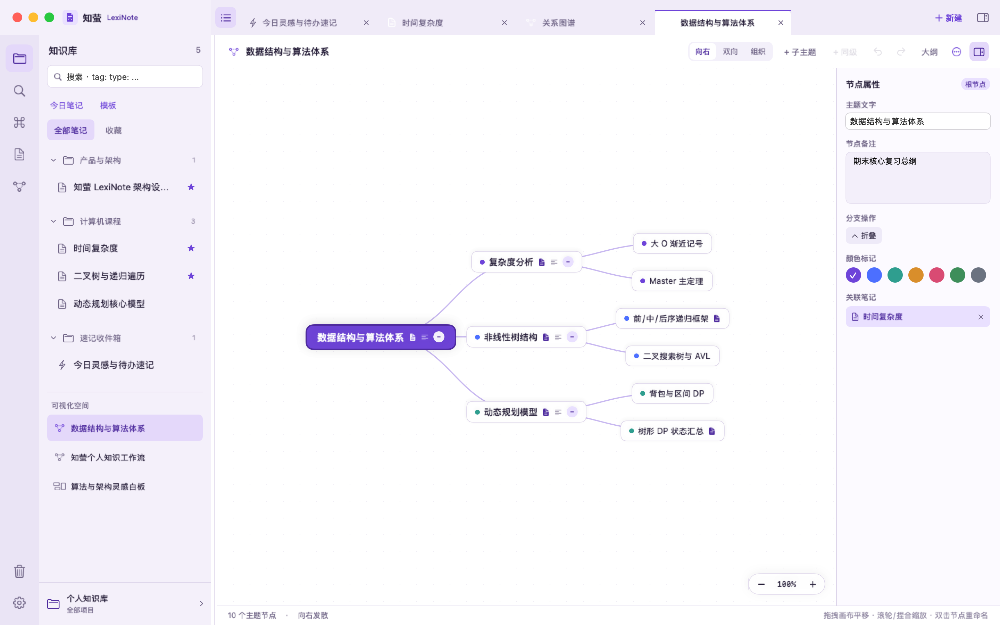
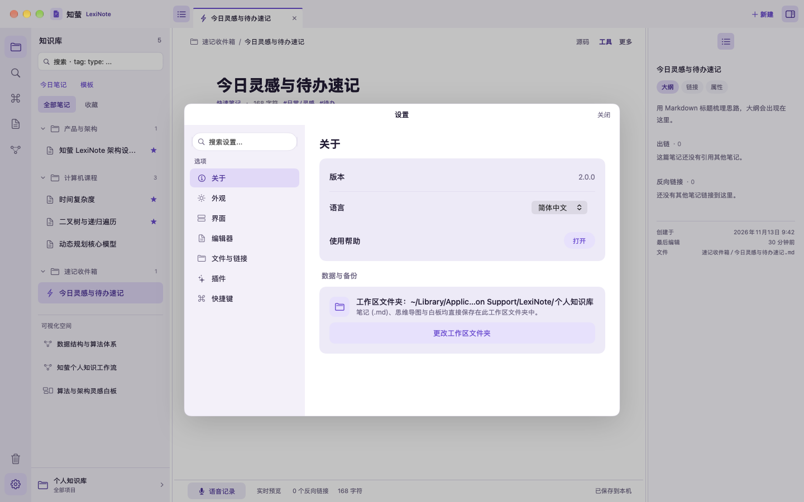
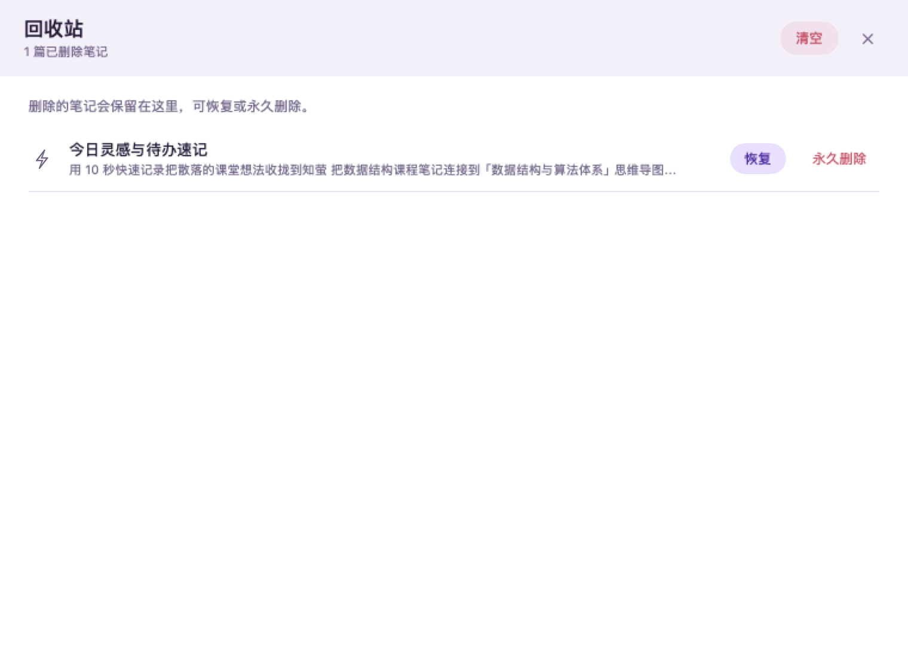
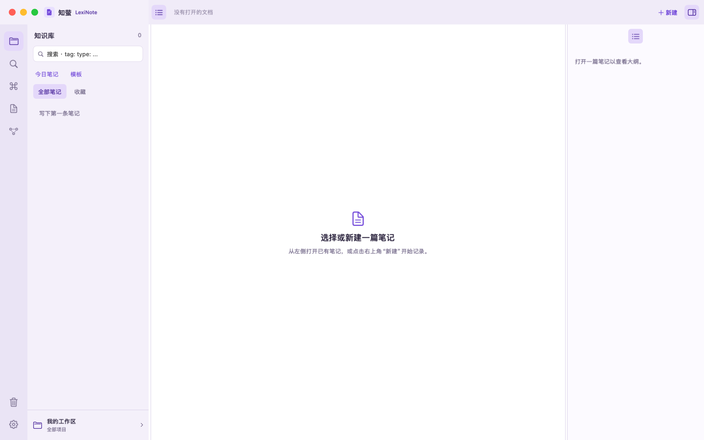

# 知萤 LexiNote · macOS

## 分支选择

当前为 **macOS** 分支，应用项目位于仓库根目录。

- [HarmonyOS：鸿蒙工程](https://github.com/peryixing-lab/LexiNote/tree/HarmonyOS)
- [Windows：Windows 工程](https://github.com/peryixing-lab/LexiNote/tree/Windows)
- [macOS：macOS 原生工程](https://github.com/peryixing-lab/LexiNote/tree/macOS)
- [main：项目概览、Harness 插件和共享文档](https://github.com/peryixing-lab/LexiNote/tree/main)

克隆当前平台：

```sh
git clone --branch macOS --single-branch https://github.com/peryixing-lab/LexiNote.git
cd LexiNote
```


把「知萤 LexiNote」的 HarmonyOS 桌面工作区，重做为 **Apple 芯片原生 macOS 应用**。界面使用 SwiftUI + AppKit 文本引擎重写，功能落在本地 Markdown 文件上；HarmonyOS 的沉浸光感 / HDS 材质改为纯色分层，并在 macOS 26+ 使用 Apple **Liquid Glass**。



> 窗口控制使用 macOS 原生红绿灯（关闭 / 最小化 / 全屏，位于系统标准的左上角），「知萤 LexiNote」标识紧挨红绿灯并处于同一水平线。上图为真实窗口捕获；窗口未激活时红绿灯会呈系统灰色，激活后恢复彩色。下图为浅色与深色工作区。

| 浅色 | 深色 |
| --- | --- |
|  |  |

## 功能

| 模块 | 已实现 |
| --- | --- |
| 桌面工作区 | 52pt 标题栏、56pt 图标栏、可拖动侧栏、标签页、右侧检查器、40pt 状态栏 |
| 弹窗 | 设置与回收站为原生模态弹窗，不占用标签页；关闭后回到原文档 |
| 写作 | 源码编辑、实时渲染预览、阅读视图；标题 / 标签 / 字符数与自动保存 |
| Markdown | 标题、段落、列表、待办、引用、`[!NOTE]` 等标注、代码块与语言高亮、表格、图片、分隔线、`$…$` / `$$…$$` 公式 |
| 知识连接 | `[[双向链接]]`、出链、反向链接、未创建链接、可点击大纲、笔记属性 |
| 检索 | 侧栏即时过滤、`tag:` / `type:` / `notebook:` / `path:` 语法、快速切换与新建 |
| 命令 | 56 条可执行命令的 ⌘K 命令面板；格式、视图、外观与文件操作菜单 |
| 可视化 | 力导向关系图谱、可编辑思维导图、可拖动卡片白板 |
| 组织 | 知识库 / 笔记本 / 标签 / 收藏 / 置顶 / 回收站 / 模板 / 每日笔记 |
| 外观 | 原始主题 + 鸢尾紫、玫瑰粉、暖杏橙、森林绿、晴空蓝、石墨灰；自定义背景与正文色；浅色 / 深色 / 跟随系统 |
| 系统 | 原生菜单与快捷键、原生红绿灯、Liquid Glass（macOS 26+）、系统材质回退、在 Finder 中显示、Markdown 导入与 JSON 备份 |
| 数据 | 标准 Markdown + YAML Frontmatter，可随时用其他编辑器打开 |
| 插件（实验性） | ZIP 安装、逐项权限、WKWebView 隔离运行时、原生插件与 Obsidian 兼容子集 |

### 界面速览

| 命令面板 | 关系图谱 |
| --- | --- |
|  |  |

| 思维导图 | 设置弹窗 |
| --- | --- |
|  |  |

| 回收站弹窗 | 全新安装（空工作区） |
| --- | --- |
|  |  |

更多状态见 [docs/screenshots](docs/screenshots)：检查器、阅读视图、快速切换、白板、深色命令面板、外观设置、欢迎引导。

### Liquid Glass 与材质

- macOS 26+：标题栏、命令面板与 Toast 使用 SwiftUI `GlassEffect` / Liquid Glass；可在「设置 → 外观 → 材质与动效」关闭。
- 较低版本：同一位置回退到 `NSVisualEffectView` / 系统材质。
- HarmonyOS 的沉浸光感、HDS 模糊与渐变全部替换为 **纯色分层 + 0.5pt 发丝线**，与桌面截图中的浅紫体系一致。

## 构建与运行

要求：**Apple Silicon Mac**、macOS 14+、Xcode 27（Swift 6.4 工具链；命令行工具也可）。Liquid Glass 需要 macOS 26+，否则自动回退。

### 直接构建 .app（推荐）

```sh
./scripts/build.sh
open build/LexiNote.app
```

产物：`build/LexiNote.app`（arm64，ad-hoc 签名）。

### 用 Xcode

```sh
open LexiNote.xcodeproj
```

选择 `LexiNote` scheme 与 `My Mac` 运行。工程使用 Xcode 的 synchronized folder，`Sources/LexiNoteMac/` 下新增的 Swift 文件会自动纳入编译。

命令行：

```sh
./scripts/build-xcode.sh
open build/xcode-derived/Build/Products/Release/LexiNote.app
```

### 创建 DMG

```sh
./scripts/package-dmg.sh
```

产物为 `build/LexiNote-2.0.1-arm64.dmg`。当前仅支持 Apple Silicon；ad-hoc 签名，未做 Apple 公证。

## 快捷键

| 动作 | 快捷键 | 动作 | 快捷键 |
| --- | --- | --- | --- |
| 命令面板 | ⌘K | 快速切换文档 | ⌘P |
| 新建笔记 | ⌘N | 新建快速笔记 | ⇧⌘N |
| 保存 | ⌘S | 今日笔记 | ⌘D |
| 从模板新建 | ⇧⌘T | 阅读视图 | ⌘E |
| 查找 | ⌘F | 关闭标签 | ⌘W |
| 侧边栏 | ⌃⌘S | 检查器 | ⌥⌘S |
| 关系图谱 | ⌘G | 在 Finder 中显示 | ⇧⌘R |
| 导出 Markdown | ⇧⌘E | 导入 Markdown | ⌘O |
| 加粗 / 倾斜 | ⌘B / ⌘I | 高亮 | ⇧⌘H |
| 设置 | ⌘, | 上一个 / 下一个标签 | ⌃⇧[ / ⌃⇧] |

主窗口没有打开的标签时点击「关闭标签」，会关闭窗口；红绿灯始终走 macOS 原生行为。

## 数据位置

默认写入：

```text
~/Library/Application Support/LexiNote/
  我的工作区/          # 全新安装时为空
    （新建笔记后才会出现 Markdown 文件）
  library.json         # 工作区元数据
  session.json         # 标签页与会话
```

- **全新安装不预置任何笔记、导图或白板**；首次启动只有 1 个空工作区「我的工作区」。截图中的内容来自内存演示数据，仅用于生成文档，不会写入你的知识库。
- 每篇笔记开头是稳定主键、标题、笔记本、类型、标签、属性与时间戳的 Frontmatter。
- 修改标题会同步重命名文件；修改笔记本会移动到对应文件夹。
- 回收站通过 Frontmatter 的 `trashed` 时间标记，永久删除才移除文件。
- 需要便携目录时，可用环境变量覆盖：

```sh
LEXINOTE_STORE="$HOME/Documents/LexiNote" ./build/LexiNote.app/Contents/MacOS/LexiNote
```

> 如果你把应用放在受 macOS 沙盒或权限限制的位置，写入失败会显示「保存失败 · 点击重试」，数据仍保留在内存中，可先导出备份。

## 验证

```sh
# 1. 落盘、重新载入、Frontmatter、搜索、反链、图谱、回收站、导图
./scripts/selftest.sh
# SELFTEST PASS

# 2. 重新生成 docs/screenshots（真实 NSHostingView + 原生窗口）
./scripts/snapshot.sh
```

自检会使用 `build/selftest-vault`，不会接触你的真实知识库。

自检包含 Harness 1.5.0 与 Obsidian 兼容插件。运行前从 [Release](https://github.com/peryixing-lab/LexiNote/releases/tag/v2.0.1) 下载 Harness ZIP，或使用 main 分支的 `plugins/harness/` 自行构建，将 ZIP 放入本工程的 `tests/fixtures/harness-lexinote-harness.zip`。也可通过 `LEXINOTE_HARNESS_ZIP` 指定测试包的绝对路径。

## 项目结构

```text
Sources/LexiNoteMac/
  App/           入口、菜单、自检、截图
  Core/          主题引擎、数据模型、Markdown 解析、存储、命令、设置
  UI/            工作区装配、编辑器 NSTextView、预览、检查器、面板、图谱、
                 思维导图、白板、设置
  Resources/     AppIcon 资源目录（Xcode）
HarmonyOS 分支/entry/  鸿蒙源码（移植依据，见分支入口）
docs/specs/      从原工程提取的工作区、主题设置、核心功能规格
docs/screenshots/  最终界面截图
scripts/         构建、运行、自检、截图
```

### 代码要点

- `Core/Theme.swift`：按原 `LexiTheme.ets` 的 `mix / luminance / contrast / readable / fitText` 逐项移植，保留原始亮/暗色 22 个关键色值与 6 个预设强调色。
- `Core/Markdown.swift`：块级/行内 Markdown 解析、标注、公式块、代码围栏、表格、双链与大纲；`LatexRenderer` 将常见 LaTeX 转成可读 Unicode，避免引入 WebView。
- `UI/EditorBridge.swift`：`NSTextView` 编辑引擎，保留系统撤销、查找、拼写检查、行内 Markdown 着色与列表续写。
- `UI/RootView.swift`：标题栏 / 图标栏 / 侧栏 / 标签页 / 空状态；`UI/NoteWorkspace.swift`：编辑器三态与状态栏。
- `Core/AppModel.swift`：本地 Markdown 读写、会话恢复、搜索、反链、图谱、导图、白板、回收站与导入导出。

## 与 HarmonyOS 版的差异

这是一次**界面与核心写作体验**的原生移植，不是逐行复刻。保留桌面布局、视觉体系、快捷键语义与本地文件模型；以下能力暂未移植或采用替代实现：

| 项 | HarmonyOS 版 | macOS 版 |
| --- | --- | --- |
| 实时预览 | 点击块内联编辑 | 整页渲染预览；悬停段落点「编辑」跳到源码对应行，源码模式完整编辑 |
| 公式 | 内置 KaTeX 离线排版 | 原生 Unicode/衬线近似渲染，覆盖常见希腊字母、分式、根号、上下标、矩阵；复杂公式保留源码 |
| 语音 | 离线语音识别 | 「语音记录」打开速记面板，可配合 macOS 系统听写使用 |
| 插件 | 原生插件宿主 + Obsidian 兼容层 | 实验性 WKWebView 插件宿主、ZIP 安装与逐项授权；兼容范围以实际测试为准 |
| 生态联动 | 词萤 / 集萤 / 分享剪藏 / 卡片 | 未移植 |
| 多窗口 | 文档窗口、分屏、标签组 | 单主窗口 + 标签页；设置与回收站为模态弹窗 |
| 导出 | Markdown / JSON / PDF | Markdown / JSON 备份；PDF 未移植 |
| 语言 | 中 / 英 | 简体中文 |
| 材质 | HDS 沉浸光感 | 纯色分层 + Liquid Glass（macOS 26+）+ 系统材质回退 |

更细的映射与取舍见 [macOS 移植说明](docs/macOS-port-notes.md)。

## 许可证与致谢

- 本项目继承原工程的 **GNU General Public License v3.0**，见 [LICENSE](LICENSE)。
- **知萤 LexiNote**（HarmonyOS / ArkTS / ArkUI）的源码位于 [HarmonyOS 分支](https://github.com/peryixing-lab/LexiNote/tree/HarmonyOS)，macOS 版沿用其界面与设计体系，请遵循仓库的许可与署名要求。
- 应用图标来自原工程 `docs/design/`；截图中的笔记内容为移植演示数据，仅用于文档，不随应用安装。
- 感谢项目与社区贡献者。macOS、HarmonyOS 和 Windows 版在本仓库统一维护和发布。

## 参与贡献

提交本系统的 PR 前，请阅读 [本分支贡献指南与 PR 规范](CONTRIBUTING.md)，并将 base 选择为 `macOS`。其他系统及共享插件规范见 [统一入口](https://github.com/peryixing-lab/LexiNote/blob/main/docs/PR_GUIDELINES.md)。
