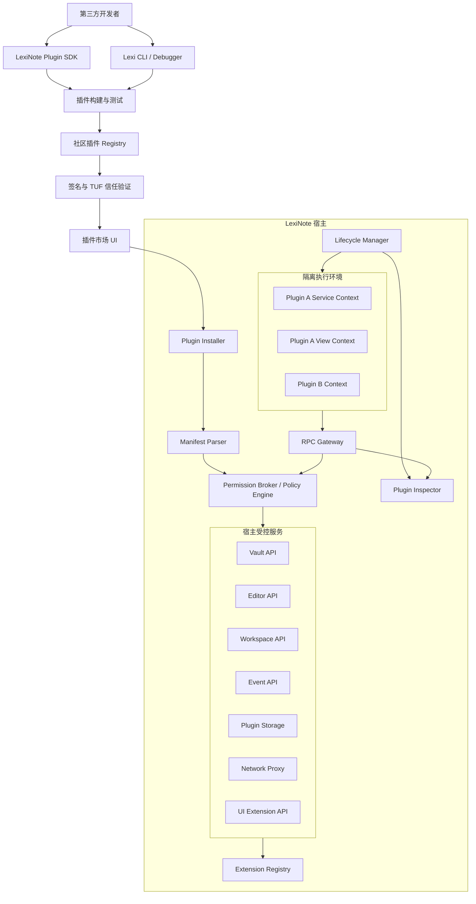
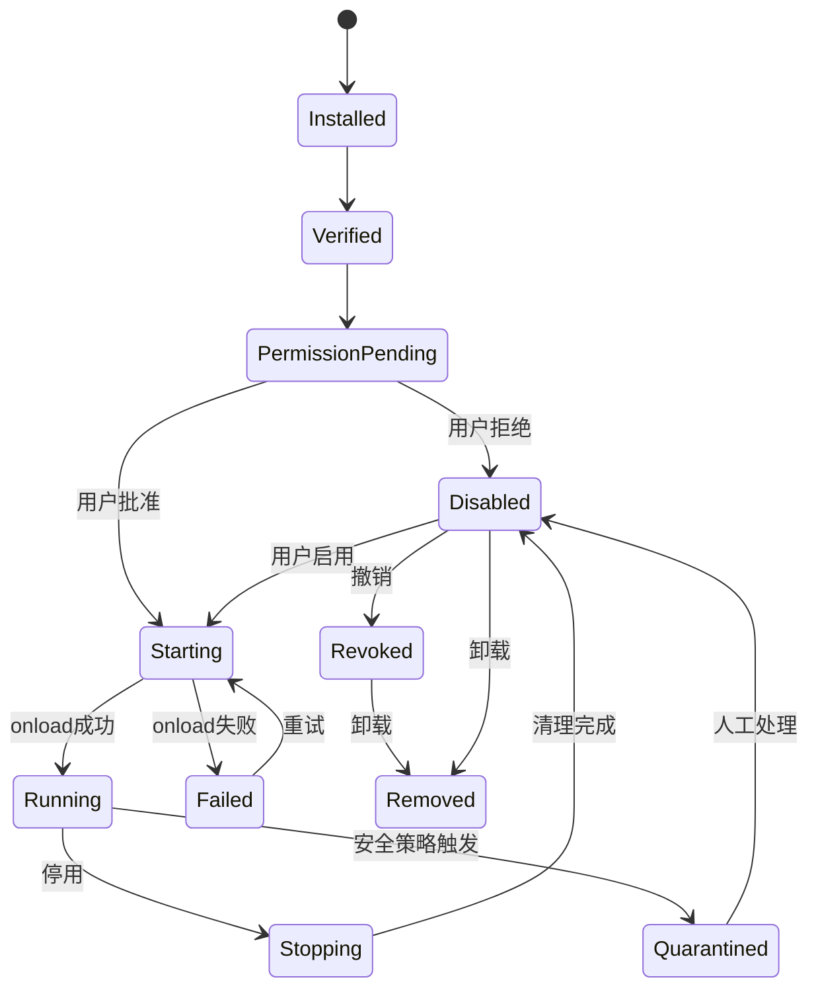
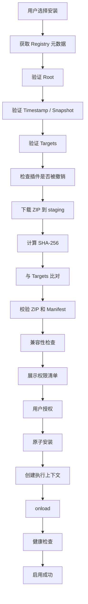
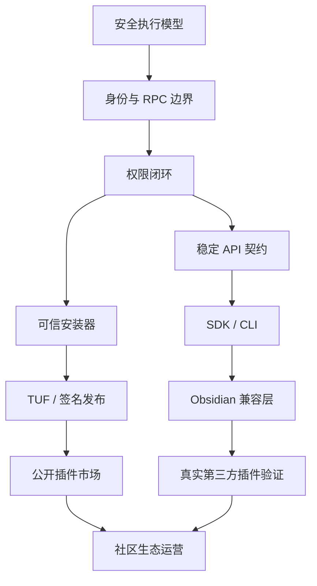

# LexiNote 第三方插件生态总体架构与整改 RFC

> **评审状态：** 本文是正在评审的设计提案。标为 Proposed 的内容不代表已实现或已达成共识；作者无法联系期间作出的假设（见桥接规范 §17.6）须经上游维护者确认后才生效。

**文档编号：** LEXI-RFC-PLUGIN-001  
**版本：** 1.0.0  
**状态：** Proposed（待架构评审）  
**编制日期：** 2026-11-03  
**适用项目：** LexiNote  
**目标平台：** HarmonyOS Phone / Tablet / PC  
**基线仓库：** https://github.com/ZhangJing-gugugaga/LexiNote  
**审查基线：** `main`，commit `c1863ff18607eec8f5170ec0c5d7f4c34eebddc4`

---

# 0. 执行摘要

## 0.1 项目背景

LexiNote 已经初步建立第三方插件基础设施，包括：

- 插件 SDK 与 TypeScript 类型声明。
- Manifest v2 插件清单。
- 插件运行时与 ArkWeb 桥接。
- 插件生命周期管理。
- 插件权限 Broker。
- 插件安装、卸载、升级与回滚。
- 插件市场索引。
- Registry Trust 信任链验证器。
- 插件 CLI。
- Plugin Inspector。
- 自动化回归测试。

这些工作说明 LexiNote 已经从简单的插件加载器进入插件平台建设阶段。

但是，现有系统仍然存在一些架构性问题：

1. 沙箱 PoC 与实际插件业务执行路径尚未真正合并。
2. Manifest v2 的细粒度能力尚未全部进入实际授权执行链。
3. 插件 SDK、宿主 API、兼容层和运行时之间还需要建立更严格的单一契约。
4. 市场安装路径与 Registry Trust 验证器尚未形成完整闭环。
5. 开发者文档、SDK 发布和自动化 CI 尚未形成稳定的外部交付体系。
6. Obsidian 兼容能力还不足以承载复杂插件迁移。

本 RFC 的任务不是推翻已有架构，而是在保留有效基础设施的前提下，完成插件生态的系统性整改。

## 0.2 最终建设目标

LexiNote 应当成为一个支持独立第三方开发者的插件平台。

开发者应当能够：

1. 独立获取官方 SDK。
2. 创建插件项目。
3. 使用 TypeScript 编写插件。
4. 在本地和真机环境调试。
5. 调用公开、稳定的宿主 API。
6. 声明插件所需权限。
7. 运行自动化测试。
8. 生成标准插件安装包。
9. 对插件进行签名和发布。
10. 将插件提交到社区市场。
11. 发布新版本。
12. 通过平台完成更新、回滚和撤销。

以上流程不应要求开发者修改 LexiNote 核心源码。

同时，用户应当能够：

- 查看插件的来源和开发者。
- 查看插件请求的全部权限。
- 独立批准或拒绝权限。
- 随时撤销权限。
- 停用和卸载插件。
- 查看插件错误和资源使用情况。
- 在更新失败时恢复之前的版本。

## 0.3 核心架构原则

本 RFC 确立以下原则：

| 原则 | 具体要求 |
|---|---|
| 插件独立性 | 第三方插件不依赖修改宿主源码 |
| 安全隔离 | 不可信插件不能直接访问宿主内部对象 |
| 最小权限 | 未声明、未授权的能力一律拒绝 |
| 单一契约 | SDK、Manifest、宿主和测试共用同一 API 定义 |
| 生命周期完整 | 所有插件资源必须能够追踪和回收 |
| 版本可控 | 插件、SDK、宿主 API 分别进行版本管理 |
| 发布可信 | 安装包必须经过完整性与来源验证 |
| 兼容渐进 | 通过适配层逐步兼容 Obsidian API |
| 向后兼容 | 旧插件迁移不能破坏已有用户数据 |
| 可观测 | 插件运行状态、权限和错误可以被审计 |

**最重要的架构决定：**

采用：

**Obsidian 兼容层 + LexiNote 原生插件 API + 独立插件安全运行时 + 可信插件分发体系。**

不以完整复制 Obsidian 内部实现为目标，也不允许第三方插件直接获得宿主内部权限。

---

# 1. 当前架构审查与问题基线

## 1.1 已有基础设施

以下模块已经存在，应当优先复用和演进，而不是重新开发一套平行系统。

| 模块 | 当前文件 | 当前基础 |
|---|---|---|
| SDK | `packages/lexinote-plugin-sdk/` | 类型、契约、能力助手 |
| Manifest | `LexiPluginManifestV2.ets` | v2 清单解析 |
| 运行时 | `LexiPluginRuntime.ets` | ArkWeb RPC 和插件管理 |
| 生命周期 | `LexiPluginLifecycleManager.ets` | 插件状态管理 |
| 权限 | `LexiPermissionBroker.ets` | RPC 方法授权矩阵 |
| 权限持久化 | `LexiPermissionStore.ets` | 授权记录 |
| 扩展注册 | `LexiExtensionRegistry.ets` | 资源所有权管理 |
| 安装 | `LexiPluginInstaller.ets` | ZIP、版本、回滚 |
| 包校验 | `LexiPackageVerifier.ets` | 包结构与完整性检查 |
| 信任链 | `LexiRegistryTrust.ets` | TUF 风格元数据验证 |
| 更新策略 | `LexiUpdatePolicy.ets` | 权限变化与更新策略 |
| Inspector | `LexiPluginInspector.ets` | 运行状态与错误报告 |
| 市场 | `LexiPluginMarketModel.ets` | 市场索引解析 |
| CLI | `tools/lexi-cli/lexi.cjs` | 创建、校验、打包、签名、发布 |
| 模板 | `tools/lexinote-plugin-template/` | TypeScript 插件模板 |

## 1.2 已确认的架构问题

### P0-01：业务插件尚未真正进入独立沙箱

实际插件运行路径：

- `LexiPluginRuntimeHost.ets`
- `LexiPluginRuntime.ets`
- `lexinote_plugin_runtime.html`
- `lexinote_plugin_shim.js`

当前插件 shim 的 `loadPlugin()` 仍然通过：

`new Function('require', 'module', 'exports', code)`

执行插件源码。

多个插件实例共享同一个运行时页面的 JavaScript 全局环境。

虽然项目已经存在：

- `LexiSandboxHost.ets`
- `lexinote_plugin_sandbox.html`
- `lexinote_sandbox_poc.html`
- `lexinote_sandbox_probe.js`
- `LexiPluginExecutionContext.ets`

但 SandboxHost 仍然是无头 PoC，不承担真实业务插件执行。

**整改要求：** 将沙箱从实验性组件变成正式插件运行时的唯一执行边界。

### P0-02：身份令牌与插件上下文需要进一步隔离

当前运行时使用宿主铸造的凭据映射插件身份：

`credential → pluginId`

这是正确的身份认证基础。

但共享 JavaScript 页面仍然存在跨插件全局对象访问的风险。

`lexinote_workspace_shim.js` 还维护会话令牌和插件加载入口。

不能只依靠令牌判断身份，而忽略插件代码可以接触哪些 JavaScript 对象。

**整改要求：**

- 插件不能接触页面会话令牌。
- 插件不能访问其他插件的身份凭据。
- 插件不能直接操作其他插件的执行上下文。
- 插件不能通过共享全局对象访问宿主控制面。
- 所有权限均由宿主端上下文绑定和校验。

### P0-03：Manifest v2 与权限执行链尚未完全一致

当前 Manifest v2 已经定义：

- Vault read/write/delete。
- Editor read/write。
- Workspace commands/views。
- Network origins/methods。
- Clipboard read/write。
- Storage quota。
- Notifications。

但是 `LexiPluginManager.capabilityTagsOf()` 目前仍主要从传统权限模型生成：

- `vault.write`
- `network:host`
- `clipboard`

`LexiManifestV2Normalized` 也保留了 legacy 形状，以便兼容现有授权模型。

这意味着 Manifest v2 的部分细粒度声明还没有成为独立的实际授权规则。

**整改要求：** Manifest 声明、用户授权、RPC 方法和实际宿主操作必须形成一一对应关系。

### P0-04：Registry Trust 尚未完全进入市场主流程

已有 `LexiRegistryTrust.ets`，并有对应的 `plugin-registry-trust.cjs` 测试。

但当前市场路径仍然存在：

`LexiPluginMarketSheet → fetchMarketIndex → parseMarketIndexResult`

需要把完整的签名元数据验证接入实际市场索引获取和安装流程。

此外，市场模型仍兼容旧版裸数组索引。旧格式可能缺少 SHA-256。

**整改要求：**

生产市场不得允许缺少受信任哈希的远程插件安装。

本地开发侧载与正式市场安装必须采用不同的信任策略。

### P1-01：Obsidian API 兼容能力不足

模板 README 已明确列出尚未完整支持的接口：

- Modal。
- Menu。
- Suggest。
- Setting Builder。
- Code Block Processor。
- Bases。
- CM6 扩展。

需要通过兼容矩阵和真实插件夹具推进，而不是简单增加类型声明。

### P1-02：SDK 尚未形成成熟的独立发行体系

当前 SDK：

`packages/lexinote-plugin-sdk/`

已有 package.json、类型和契约快照。

但 SDK 包的入口仍指向 TypeScript 源码，模板也维护自己的类型声明副本。

需要统一 SDK 构建、发布和版本契约。

### P1-03：开发者文档未完整纳入 Git

根目录 `.gitignore` 忽略 `/docs/`。

已有文档生成器和文档门禁，但公开克隆仓库时不能保证获取完整开发文档。

本 RFC 应放在新建的 `/rfcs/` 目录中，确保进入 Git 版本管理。

### P1-04：市场 UI 已有真机问题

`tools/plugin-dist/known-issues.md` 记录了：

- KI-1：已安装插件列表占满 Sheet 后，远程市场列表无法滚动到达。
- KI-2：已安装列表与磁盘状态不一致，出现无法正常卸载的记录。
- KI-3：设备私有目录权限问题。

这些问题需要进入正式回归测试，而不能只保留在本地问题记录中。

## 1.3 现状与目标必须区分

本 RFC 使用以下状态标记：

- **Existing：** 已有源码或测试证据。
- **Partial：** 有部分实现，但尚未形成完整闭环。
- **Proposed：** 本 RFC 提议建设的能力。
- **Verify：** 需要通过真机、集成测试或安全审计进一步确认。

任何开发任务不得仅因为存在类名、接口声明或 PoC 就被标记为完成。

---

# 2. 总体架构

## 2.1 目标架构



## 2.2 模块职责边界

### Plugin SDK

只负责向开发者提供：

- 类型声明。
- API 客户端。
- 生命周期基类。
- 事件与命令注册助手。
- Manifest 定义。
- 构建配置。
- 测试工具。

SDK 不应持有宿主内部实现。

### Plugin Runtime

负责：

- 创建执行上下文。
- 装载插件。
- 运行插件代码。
- 管理插件之间的执行隔离。
- 管理 RPC 通道。
- 回收执行环境。

### Permission Broker

负责：

- 解析调用身份。
- 解析当前插件能力。
- 检查用户授权。
- 检查资源范围。
- 检查 API 方法。
- 返回机器可读的授权结果。

### Extension Registry

负责：

- 命令注册。
- 视图注册。
- 事件订阅。
- Markdown 扩展。
- 编辑器扩展。
- 设置页面注册。
- Ribbon 和 UI 组件注册。

所有资源必须具有明确的插件所有权。

### Plugin Installer

负责：

- 包校验。
- 安装。
- 版本管理。
- 数据迁移。
- 升级。
- 回滚。
- 卸载。

不得直接承担插件运行时权限判断。

### Registry / Marketplace

负责：

- 插件元数据。
- 发布者信息。
- 版本索引。
- 签名元数据。
- 撤销信息。
- 插件搜索与发现。

市场不能直接执行插件代码，也不能成为权限判断的最终执行者。

---

# 3. 插件安全运行时

这是整个整改工作的最高优先级。

## 3.1 执行隔离模型

建议采用三级隔离：

| 层级 | 隔离对象 | 目标 |
|---|---|---|
| Plugin | 不同插件 | 防止插件 A 访问插件 B |
| Activation | 同一插件的不同激活周期 | 防止旧实例残留 |
| Context | 同一插件的 service/view/editor 等执行面 | 防止上下文权限混用 |

每个执行上下文都必须具有独立的 `contextId`。

建议身份模型：

```typescript
interface PluginExecutionIdentity {
  pluginId: string;
  activationId: string;
  contextId: string;
  contextKind:
    | 'service'
    | 'view'
    | 'editor'
    | 'markdown'
    | 'theme';
}
```

该对象只允许宿主内部使用。

插件不能自行创建或修改其中的身份字段。

## 3.2 沙箱实现

优先复用现有 ArkWeb 技术栈。

每个不可信插件执行上下文使用独立 iframe：

```html
<iframe sandbox="allow-scripts"></iframe>
```

必须遵守：

- 禁止 `allow-same-origin`。
- 禁止 `allow-top-navigation`。
- 禁止不必要的 popup。
- 禁止插件直接访问宿主 DOM。
- 禁止直接访问宿主 JavaScript 全局对象。
- 禁止直接读取宿主本地文件。
- 禁止直接使用浏览器持久化存储。
- 禁止插件自行建立未经授权的网络连接。

iframe 应采用 opaque origin。

插件与宿主之间只能通过专属 MessageChannel 通信。

CSP 初始策略：

```text
default-src 'none';
connect-src 'none';
object-src 'none';
base-uri 'none';
form-action 'none';
frame-ancestors 'none';
```

插件所需脚本、样式和图片由宿主按照安装包资源白名单提供。

不允许为了兼容插件而在宿主运行页面开放 `unsafe-eval`。

对于需要动态执行的旧版 CommonJS 插件，优先在构建阶段打包为 IIFE，而不是让宿主使用 `new Function` 执行原始源码。

## 3.3 MessageChannel 握手

建议采用一次性通道初始化。

流程：

1. 宿主创建 iframe。
2. 宿主生成随机 nonce。
3. 宿主创建 MessageChannel。
4. 宿主将 port2 转移到指定 iframe。
5. iframe 只接受首次有效初始化消息。
6. 宿主将 port1 与宿主内部身份记录绑定。
7. 通道建立后，不再通过全局对象传递身份。
8. 插件停用时关闭端口并撤销上下文。

宿主身份记录：

```typescript
interface HostContextRecord {
  contextId: string;
  pluginId: string;
  activationId: string;
  kind: string;
  port: MessagePort;
  createdAt: number;
  revoked: boolean;
}
```

插件侧只拿到自己的通信端口，不获得 `pluginId`、`activationId` 或宿主令牌作为可信身份。

`pluginId` 即使出现在插件自己的日志和 payload 中，也只能视为普通自述字段。

## 3.4 RPC 协议

统一使用 JSON 可序列化消息。

请求：

```typescript
interface RpcRequest {
  v: number;
  type: 'request';
  id: string;
  method: string;
  payload: unknown;
  deadline?: number;
}
```

响应：

```typescript
interface RpcResponse {
  v: number;
  type: 'response';
  id: string;
  ok: boolean;
  data?: unknown;
  error?: {
    code: string;
    message: string;
    retryable: boolean;
  };
}
```

事件：

```typescript
interface RpcEvent {
  v: number;
  type: 'event';
  sequence: number;
  topic: string;
  name: string;
  payload: unknown;
}
```

协议要求：

- 请求 ID 在上下文内唯一。
- 未知协议版本拒绝。
- 未知方法拒绝。
- payload 必须经过 schema 验证。
- 每次请求必须绑定原始 contextId。
- 响应必须匹配原始 request ID。
- 超时后自动清理 pending。
- 端口关闭后拒绝新请求。
- 超大消息拒绝。
- 限制并发请求数量。
- 限制事件队列长度。
- 不允许插件通过伪造请求身份跨越上下文。

建议初始预算：

| 项目 | 建议上限 |
|---|---:|
| 单次 RPC payload | 256 KB |
| 单上下文并发 RPC | 32 |
| RPC 默认超时 | 10 秒 |
| 生命周期清理超时 | 5 秒 |
| 单事件队列 | 500 |
| 单插件执行上下文 | 按设备能力动态限制 |

以上属于拟定默认值，必须在 HarmonyOS 真机基准测试后固化。

## 3.5 安全边界

禁止以下设计：

```typescript
// 禁止：把页面会话身份暴露给插件
window.LexiPluginShim.setSessionToken(token);

// 禁止：插件自行声明身份
host.call(method, {
  pluginId: 'another-plugin'
});

// 禁止：插件直接访问全局宿主对象
window.lexiHost.call(...);

// 禁止：插件跨上下文直接访问其他插件实例
window.plugins.get('another-plugin');
```

允许的设计：

```typescript
// 插件只调用 SDK 提供的能力接口
await app.vault.read('notes/demo.md');

await app.commands.register({
  id: 'hello',
  name: 'Hello',
  callback: async () => {
    new Notice('Hello LexiNote');
  }
});
```

身份由当前 MessagePort 在宿主侧解析。

## 3.6 安全隔离验收

必须通过以下测试：

1. 插件 A 不能读取插件 B 的执行上下文。
2. 插件 A 不能读取插件 B 的存储。
3. 插件 A 不能注销插件 B 的命令。
4. 插件 A 不能执行插件 B 的私有回调。
5. 插件不能访问父窗口 DOM。
6. 插件不能访问宿主 localStorage。
7. 插件不能访问宿主 session token。
8. 插件不能通过伪造 pluginId 获得权限。
9. 插件不能在卸载后继续发送有效 RPC。
10. 插件不能通过重新创建 iframe 恢复已经撤销的授权。

安全 PoC 测试通过不等于业务运行时已经安全。

最终必须在真实业务加载路径中验证。

---

# 4. Manifest 与权限体系

## 4.1 Manifest v2 保留原则

当前 `LexiPluginManifestV2.ets` 已经具备严格字段校验、未知能力拒绝和 v1 迁移基础。

不建议立即废弃 v2。

先完成：

1. v2 细粒度能力归一化。
2. Broker 授权矩阵扩展。
3. 权限存储升级。
4. 授权 UI 完整化。
5. 所有 RPC Handler 对账。

在这些工作完成之前，不应仅为增加字段而推出 Manifest v3。

## 4.2 建议的 Manifest v3 目标结构

v3 是未来演进方案，不代表当前解析器已经支持。

```json
{
  "manifestVersion": 3,
  "id": "example-plugin",
  "name": "Example Plugin",
  "version": "1.0.0",
  "author": "Example Developer",
  "license": "MIT",
  "repository": "https://github.com/example/plugin",
  "publisher": {
    "id": "publisher-example",
    "keyId": "publisher-key-001"
  },
  "entrypoints": {
    "service": "dist/main.js",
    "views": "dist/views.js",
    "markdown": "dist/markdown.js"
  },
  "compatibility": {
    "lexinote": {
      "min": "1.0.0",
      "maxExclusive": "2.0.0"
    },
    "apiVersion": "1.0.0",
    "obsidianApiLevel": "1.14.4"
  },
  "platforms": [
    "harmonyos-phone",
    "harmonyos-tablet",
    "harmonyos-pc"
  ],
  "capabilities": {
    "vault": {
      "read": {
        "enabled": true,
        "paths": ["notes/**/*.md"]
      },
      "write": {
        "enabled": false,
        "paths": []
      },
      "delete": {
        "enabled": false,
        "paths": []
      }
    },
    "editor": {
      "readActive": true,
      "writeSelection": false,
      "writeDocument": false,
      "extensions": "none"
    },
    "workspace": {
      "commands": true,
      "views": true
    },
    "network": {
      "origins": [
        "https://api.example.com"
      ],
      "methods": ["GET"],
      "maxRequestBytes": 65536,
      "maxResponseBytes": 1048576
    },
    "clipboard": {
      "read": false,
      "write": false
    },
    "storage": {
      "quotaBytes": 1048576
    },
    "notifications": {
      "enabled": false
    }
  },
  "dependencies": {},
  "optionalDependencies": {},
  "dataMigrations": []
}
```

注意：

- Manifest 不包含自身 ZIP 的 SHA-256。
- 包指纹归属于 Registry 的受签名目标元数据。
- 发布者身份通过受信任签名体系验证。
- 未知字段和未知能力必须拒绝。
- 版本必须采用规范 SemVer。
- 文件路径不得包含 `..`、绝对路径和未授权符号链接。
- 网络能力必须采用明确的 origin 白名单。

## 4.3 权限判定模型

实际授权必须满足：

```text
effectivePermission
  = manifestRequestedPermission
  ∩ userGrantedPermission
  ∩ hostSupportedPermission
  ∩ securityPolicy
```

任何一项不满足，都必须拒绝。

不能出现：

- Manifest 声明了，但宿主不支持却静默放行。
- 用户拒绝了，但旧授权仍然有效。
- 插件升级后新增能力自动获得权限。
- 插件通过改变自身 ID 继承其他插件授权。

## 4.4 权限矩阵

| 能力域 | 能力 | 授权粒度 |
|---|---|---|
| Vault | read | 路径范围 |
| Vault | write | 路径 + 操作 |
| Vault | delete | 路径 + 操作 |
| Editor | readActive | 当前编辑器 |
| Editor | writeSelection | 当前选区 |
| Editor | writeDocument | 当前文档 |
| Workspace | commands | 命令注册 |
| Workspace | views | 自定义视图 |
| Network | request | origin + method + 大小 |
| Clipboard | read | 独立读取权限 |
| Clipboard | write | 独立写入权限 |
| Storage | data | 配额 |
| Notifications | notify | 独立通知权限 |
| Theme | themeContribution | 样式范围 |
| Markdown | postProcessor | 渲染扩展 |

每个 RPC 方法必须绑定至少一个授权规则。

没有权限的 RPC 不得通过“方法属于 UI 域”而获得间接放行。

## 4.5 用户授权界面

安装插件时必须展示：

- 插件名称。
- 发布者。
- 插件版本。
- 来源仓库。
- 签名状态。
- 请求权限。
- 权限用途。
- 是否涉及网络。
- 网络访问域名。
- 是否修改笔记。
- 是否访问剪贴板。
- 数据存储空间。
- 权限变更情况。

建议区分：

- 必需权限。
- 可选权限。
- 高风险权限。
- 平台不支持的权限。

用户拒绝可选权限时，插件仍可在降级模式下运行。

用户拒绝必需权限时，插件不得启用。

## 4.6 授权持久化

建议授权记录结构：

```typescript
interface PluginPermissionGrant {
  pluginId: string;
  publisherKeyId: string;
  version: string;
  capabilityFingerprint: string;
  grantedCapabilities: string[];
  deniedCapabilities: string[];
  grantedAt: number;
  updatedAt: number;
  revokedAt?: number;
}
```

更新策略：

| 变化 | 行为 |
|---|---|
| 版本更新，权限不变 | 沿用授权 |
| 新增权限 | 重新询问 |
| 权限范围扩大 | 重新询问 |
| 权限减少 | 可自动收缩 |
| 发布者密钥变化 | 重新验证身份并重新授权 |
| 用户主动撤销 | 立即停用 |
| 插件被撤销 | 禁止启用 |

---

# 5. API 体系与 Obsidian 兼容策略

## 5.1 API 分层

建议将 API 划分为四层。

### A. Core API

稳定基础能力：

- Plugin。
- App。
- Notice。
- Vault。
- TFile / TFolder。
- MetadataCache。
- Events。
- Commands。
- Plugin Storage。

这些 API 是所有普通插件的基础。

### B. UI Extension API

用户界面扩展：

- Ribbon。
- Status Bar。
- Command Palette。
- Modal。
- Menu。
- Setting Tab。
- ItemView。
- WorkspaceLeaf。
- Suggest。

### C. Editor API

编辑器扩展：

- Editor。
- Selection。
- Cursor。
- Replace Range。
- Apply Changes。
- CodeMirror 6。

CM6 必须采用单独的安全策略。

### D. Advanced API

高级能力：

- Markdown Post Processor。
- MarkdownRenderer。
- Theme API。
- Custom View。
- Advanced Workspace。
- External Service Integration。

高级 API 必须拥有独立的兼容性和权限声明。

## 5.2 API 稳定等级

每个 API 必须明确标记：

| 等级 | 含义 | 兼容承诺 |
|---|---|---|
| Stable | 正式开放 | 向后兼容 |
| Experimental | 实验功能 | 允许变更 |
| Deprecated | 即将废弃 | 提供迁移窗口 |
| Internal | 宿主内部 | 不允许第三方依赖 |
| Trusted | 高风险扩展 | 额外审核与授权 |

禁止把 Internal API 暴露成 SDK 的公开类型。

禁止把 Experimental API 误标为 Stable。

## 5.3 Obsidian 兼容层

建议建立独立目录：

```text
entry/src/main/ets/core/plugin/compat/
├── obsidian/
│   ├── AppCompat.ets
│   ├── PluginCompat.ets
│   ├── VaultCompat.ets
│   ├── WorkspaceCompat.ets
│   ├── EditorCompat.ets
│   ├── MetadataCompat.ets
│   ├── MarkdownCompat.ets
│   ├── ModalCompat.ets
│   ├── MenuCompat.ets
│   └── SettingsCompat.ets
├── codemirror/
│   ├── CodeMirrorCompat.ets
│   └── ExtensionPolicy.ets
└── index.ets
```

该目录为目标结构，实施前应对照现有 shim 逐步迁移，不能直接复制文件形成两套实现。

兼容层只负责 API 转换。

底层操作仍必须进入统一的 Permission Broker。

例如：

```text
Obsidian Plugin API
        ↓
LexiNote Compatibility Adapter
        ↓
LexiNote Plugin SDK API
        ↓
RPC Gateway
        ↓
Permission Broker
        ↓
Host Service
```

## 5.4 Obsidian 兼容优先级

### 第一阶段：基础笔记能力

- Plugin。
- Vault。
- MetadataCache。
- Events。
- Commands。
- App。
- Notice。
- Workspace 基础接口。
- Editor 基础接口。

目标：能够迁移简单笔记处理、快捷命令和元数据插件。

### 第二阶段：UI 扩展

- ItemView。
- WorkspaceLeaf。
- Modal。
- Menu。
- Setting Tab。
- Suggest。
- Ribbon。
- StatusBar。

目标：能够迁移具有独立面板和交互界面的插件。

### 第三阶段：Markdown 与编辑器扩展

- Markdown Post Processor。
- MarkdownRenderer。
- CM6 StateField。
- CM6 ViewPlugin。
- Decoration。
- EditorView。

其中 CM6 代码如果需要在宿主编辑器上下文执行，必须进入 Trusted 扩展策略，不能让普通不可信 iframe 获得宿主编辑器对象。

### 第四阶段：高级兼容

- Bases。
- Advanced Workspace。
- Theme API。
- 更完整的 Markdown 组件。
- 跨插件协作。

## 5.5 兼容性测试

建立真实插件夹具：

- Calendar。
- Outliner。
- Tasks。
- Minimal Theme。

每个插件至少进行：

1. Manifest 解析。
2. 构建兼容检查。
3. API 使用面扫描。
4. 安装测试。
5. 启用测试。
6. 主要功能测试。
7. 停用测试。
8. 卸载测试。
9. 重启恢复测试。

兼容等级：

- C0：不能加载。
- C1：成功加载，基础功能可用。
- C2：主要功能可用。
- C3：核心功能完整。
- C4：通过上游插件主要测试集。

只有经过真实运行测试，才可以标记为对应兼容等级。

---

# 6. 生命周期与扩展注册

## 6.1 目标状态机



建议保留现有 Lifecycle Manager，并扩展以下状态：

- installed
- verified
- permission-pending
- starting
- running
- degraded
- failed
- stopping
- disabled
- quarantined
- revoked
- removed

所有状态变更必须记录原因。

## 6.2 生命周期规范

插件入口：

```typescript
export default class MyPlugin extends Plugin {
  async onload(): Promise<void> {
    // 注册插件资源
  }

  async onunload(): Promise<void> {
    // 清理资源
  }
}
```

建议 SDK 进一步提供：

```typescript
interface PluginLifecycleContext {
  signal: AbortSignal;
  activationId: string;
  storage: PluginStorage;
  logger: PluginLogger;
}
```

生命周期要求：

- onload 最多执行一次。
- onload 失败必须进入 failed。
- onunload 必须可重复调用而不产生副作用。
- 停用时首先停止新 RPC。
- 取消所有异步任务。
- 清除事件监听。
- 注销命令。
- 注销视图。
- 释放编辑器扩展。
- 关闭所有 MessagePort。
- 销毁 iframe。
- 吊销所有身份凭据。

## 6.3 资源所有权

统一使用：

```typescript
interface ExtensionOwnership {
  pluginId: string;
  activationId: string;
  contextId: string;
  resourceType: string;
  localId: string;
}
```

注册键：

```text
pluginId:activationId:resourceType:localId
```

禁止仅依赖全局 localId。

资源注册：

```typescript
register(pluginId, activationId, resource);
```

资源注销：

```typescript
unregister(owner, resourceId);
```

任何插件只能删除自己拥有的资源。

宿主拥有代管和强制清理权。

## 6.4 异常处理

插件出现以下情况时，宿主应自动处理：

- 无限 RPC 请求。
- 运行时异常。
- 执行超时。
- 消息体超限。
- 资源超限。
- 生命周期清理失败。
- 权限被撤销。
- 插件身份校验失败。

高风险异常应触发 quarantine，而不是简单显示错误通知。

---

# 7. SDK、CLI 与开发者体验

## 7.1 SDK 单一真源

建议统一契约来源：

```text
tools/plugin-contract/
    ↓
API Contract Generator
    ↓
packages/lexinote-plugin-sdk/
    ↓
Type Definitions
    ↓
Host Adapter
    ↓
RPC Handler
    ↓
Contract Tests
```

禁止 SDK、模板、宿主分别维护独立 API 定义。

所有生成文件必须可通过生成器重建。

生成后必须进行逐字节一致性检查。

## 7.2 SDK 包结构

目标：

```text
packages/lexinote-plugin-sdk/
├── package.json
├── README.md
├── src/
│   ├── index.ts
│   ├── Plugin.ts
│   ├── App.ts
│   ├── Vault.ts
│   ├── Workspace.ts
│   ├── Editor.ts
│   ├── Events.ts
│   ├── Commands.ts
│   ├── Storage.ts
│   ├── Notice.ts
│   └── types/
├── types/
├── schema/
├── tests/
├── examples/
└── tools/
```

SDK 必须支持：

- 标准 TypeScript 类型检查。
- CommonJS / IIFE 插件构建。
- ESM 开发入口。
- Tree Shaking。
- 版本锁定。
- API 文档生成。
- 单元测试。
- 兼容性检查。

最终 npm 包应当是独立可安装的开发依赖。

宿主运行时提供真正的 API 实现，SDK 只提供客户端封装和类型。

## 7.3 CLI 完整命令

当前已有：

```bash
lexi plugin create
lexi plugin validate
lexi plugin pack
lexi plugin sign
lexi plugin publish
```

建议扩展为：

```bash
lexi plugin create <name>

lexi plugin dev

lexi plugin build

lexi plugin validate

lexi plugin test

lexi plugin pack

lexi plugin sign

lexi plugin inspect

lexi plugin publish

lexi plugin doctor

lexi plugin compatibility
```

### 命令要求

| 命令 | 职责 |
|---|---|
| create | 创建标准项目 |
| dev | 本地开发与热重载 |
| build | TypeScript 编译与打包 |
| validate | Manifest 与包结构检查 |
| test | 自动化测试 |
| pack | 生成正式插件包 |
| sign | 使用发布者私钥签名 |
| inspect | 检查插件包与权限 |
| publish | 发布到 Registry |
| doctor | 检查开发环境 |
| compatibility | 检查 API 兼容性 |

`publish` 不能仅仅输出一个本地 targets JSON 就视为完成。

它必须进入真实发布流程，完成签名、索引生成、验证和发布结果确认。

## 7.4 开发者调试器

新增 Plugin Developer Mode。

功能：

- 插件列表。
- 当前版本。
- 生命周期状态。
- 热重载。
- 控制台日志。
- RPC 调用记录。
- 权限状态。
- 运行时异常。
- 插件资源占用。
- API 兼容性报告。
- 一键导出诊断报告。

调试模式不得自动绕过生产权限体系。

可以提供本地开发信任配置，但必须有明确提示，且不能继承到正式发布渠道。

## 7.5 插件模板

模板应当包含：

```text
my-plugin/
├── manifest.json
├── package.json
├── tsconfig.json
├── lexi.config.ts
├── src/
│   ├── main.ts
│   ├── commands/
│   ├── views/
│   ├── settings/
│   └── utils/
├── tests/
├── assets/
├── README.md
└── LICENSE
```

模板必须附带：

- 最小命令插件。
- Vault 插件。
- 自定义视图插件。
- Markdown 扩展插件。
- 设置页面插件。
- 权限声明示例。

每个示例都必须能够通过 CLI 构建、校验和测试。

---

# 8. 插件包、签名与分发

## 8.1 标准安装包

建议正式后缀：

`.lexi-plugin.zip`

包结构：

```text
example-plugin.lexi-plugin.zip
├── manifest.json
├── dist/
│   ├── main.js
│   ├── views.js
│   └── markdown.js
├── styles.css
├── assets/
├── README.md
└── LICENSE
```

不允许包含：

- node_modules。
- 临时构建文件。
- 本地密钥。
- 未声明入口。
- 可执行宿主外部脚本。
- 路径穿越条目。
- 非白名单符号链接。

继续复用 `LexiPackageVerifier` 的预算机制，并根据真机测试调整限制。

## 8.2 包安装流程



任何步骤失败，都不得把插件标记为已启用。

## 8.3 签名体系

开发签名与生产签名必须分离。

开发环境可以使用本地密钥进行签名测试。

生产环境必须采用非对称签名。

建议：

- Ed25519 或经平台支持的安全签名算法。
- 发布者私钥不进入客户端。
- Registry Root Key 固定在客户端信任配置中。
- Root Key 支持轮换。
- 发布者 Key 支持撤销。
- 发布包必须与 Targets 哈希一致。

当前 CLI 的 HMAC 开发实现不能作为生产发布者身份认证机制。

## 8.4 TUF 信任链

继续演进 `LexiRegistryTrust.ets`。

目标元数据角色：

| 角色 | 职责 |
|---|---|
| Root | 根信任锚和角色密钥 |
| Timestamp | 最新快照与过期检测 |
| Snapshot | 版本元数据一致性 |
| Targets | 插件包版本、哈希与来源 |
| Delegated Targets | 插件发布者或分类仓库授权 |

必须支持：

- 签名验证。
- 有效期验证。
- 版本单调递增。
- 回滚攻击检测。
- 撤销密钥。
- Root 轮换。
- Snapshot 一致性。
- Targets 哈希验证。
- 断网和过期处理。

建议尽量使用经过审查的 TUF 实现，避免自行实现不完整协议。

## 8.5 市场索引

新版本市场索引不再直接信任裸 JSON。

目标结构：

```text
registry/
├── metadata/
│   ├── root.json
│   ├── timestamp.json
│   ├── snapshot.json
│   └── targets.json
├── plugins/
│   ├── example-plugin/
│   │   ├── 1.0.0/
│   │   └── 1.1.0/
│   └── another-plugin/
├── schemas/
└── signatures/
```

社区市场可以继续采用 GitHub Releases 作为文件托管来源。

但下载地址不等于信任来源。

客户端必须验证元数据和插件包。

## 8.6 市场产品能力

市场应当至少包含：

- 搜索。
- 分类。
- 标签。
- 排序。
- 插件详情。
- 开发者主页。
- 版本历史。
- 更新日志。
- 权限展示。
- 兼容性标签。
- 安装数量。
- 用户评价。
- 举报入口。
- 撤销状态。
- 更新管理。

UI 必须修复已记录的 KI-1 和 KI-2。

远程列表与已安装列表必须使用独立滚动区域，状态必须以安装器真实状态为准。

---

# 9. 更新、回滚和数据管理

## 9.1 插件版本目录

继续保留 `LexiPluginInstaller` 当前的不可变版本目录思路。

建议：

```text
files/plugins/
└── example-plugin/
    ├── current.json
    ├── data/
    │   ├── data.json
    │   └── backups/
    └── .versions/
        ├── 1.0.0/
        ├── 1.1.0/
        └── 1.2.0/
```

代码版本与用户数据必须分离。

## 9.2 更新流程

1. 获取可信更新元数据。
2. 检查版本是否允许更新。
3. 检查发布者身份。
4. 下载并验证新包。
5. 比较权限变化。
6. 如果权限增加，要求用户重新授权。
7. 暂停当前插件。
8. 备份必要数据。
9. 安装到新版本目录。
10. 原子切换版本指针。
11. 创建新执行上下文。
12. 执行 onload。
13. 健康检查。
14. 成功则完成更新。
15. 失败则恢复旧版本指针。

## 9.3 数据迁移

插件可以声明数据迁移：

```typescript
interface PluginDataMigration {
  fromVersion: string;
  toVersion: string;
  migrate(input: unknown): Promise<unknown>;
}
```

要求：

- 迁移脚本运行在受限环境。
- 不允许直接修改宿主文件系统。
- 迁移前备份。
- 迁移过程具有事务性。
- 迁移失败必须恢复原数据。
- 迁移日志不记录用户笔记内容。
- 插件卸载时提供保留或删除数据选项。

## 9.4 回滚策略

回滚必须区分：

- 代码回滚。
- 配置回滚。
- 用户数据回滚。

默认只回滚代码版本。

用户数据不能在没有明确告知的情况下被旧版本覆盖。

---

# 10. 插件存储与宿主服务

## 10.1 插件独立存储

SDK 提供：

```typescript
interface PluginStorage {
  get<T>(key: string): Promise<T | null>;
  set<T>(key: string, value: T): Promise<void>;
  remove(key: string): Promise<void>;
  clear(): Promise<void>;
  keys(): Promise<string[]>;
}
```

宿主按 pluginId 隔离存储。

插件不得访问其他插件的数据目录。

配额必须由宿主强制执行，不能仅在 Manifest 中声明。

## 10.2 Vault API

建议 API：

```typescript
interface VaultAPI {
  read(path: string): Promise<string>;
  create(path: string, content: string): Promise<void>;
  modify(path: string, content: string): Promise<void>;
  delete(path: string): Promise<void>;
  rename(oldPath: string, newPath: string): Promise<void>;
  listFiles(): Promise<TFile[]>;
}
```

所有路径必须经过统一规范化。

路径范围校验必须在宿主执行，不能只依靠插件 SDK。

## 10.3 Editor API

建议区分：

- 只读快照。
- 选区修改。
- 当前文档修改。
- 高级编辑器扩展。

普通插件不得直接获取宿主内部 CodeMirror 实例。

## 10.4 Network API

禁止不可信插件直接访问任意网络。

统一使用：

```typescript
interface NetworkAPI {
  request(options: {
    url: string;
    method: string;
    headers?: Record<string, string>;
    body?: string;
  }): Promise<NetworkResponse>;
}
```

宿主执行：

- origin 白名单。
- HTTP 方法白名单。
- HTTPS 校验。
- 请求大小限制。
- 响应大小限制。
- 超时控制。
- 重定向重新校验。
- 禁止访问本地敏感地址，除非是明确的开发调试配置。
- 日志脱敏。

## 10.5 UI API

UI 扩展必须通过宿主注册。

插件不能直接修改宿主全局 UI DOM。

对于自定义视图，优先采用：

- 独立 WebView。
- 隔离 iframe。
- 宿主声明式 UI 描述。

禁止通过插件样式无边界地覆盖整个宿主界面。

---

# 11. 审核、供应链与社区治理

## 11.1 插件审核等级

建议采用三级：

| 等级 | 说明 |
|---|---|
| Community | 普通社区发布，基础自动化检查 |
| Verified | 经过人工或增强自动化审核 |
| Trusted | 高风险 API 经过专项安全审查 |

等级不是用户授权的替代品。

Verified 插件仍然需要遵守权限模型。

## 11.2 发布审核项目

每个插件必须提供：

- 插件 ID。
- 开发者身份。
- 项目仓库。
- License。
- 版本。
- Manifest。
- API 兼容版本。
- 请求权限。
- 发布包 SHA-256。
- 签名信息。
- 更新日志。
- 隐私说明。

审核重点：

1. 是否存在恶意代码。
2. 是否存在数据外传。
3. 是否请求不必要的权限。
4. 是否访问其他插件资源。
5. 是否绕过宿主网络代理。
6. 是否使用未声明入口。
7. 是否存在恶意更新行为。
8. 是否包含许可证违规依赖。

## 11.3 撤销机制

撤销插件后：

- 禁止新安装。
- 禁止新版本更新。
- 对已安装版本发出风险提示。
- 根据风险级别停用。
- 吊销相关签名密钥。
- 保留审计记录。
- 不自动删除用户数据。

对于明确恶意插件，可以通过安全策略强制隔离。

---

# 12. Plugin Inspector 与可观测性

继续演进 `LexiPluginInspector.ets`。

目标报告：

```typescript
interface PluginInspectorReport {
  pluginId: string;
  version: string;
  lifecycleState: string;
  activationId: string;
  contexts: number;
  extensionCount: number;
  permissionState: string;
  capabilityTags: string[];
  rpcCount: number;
  rpcDeniedCount: number;
  timeoutCount: number;
  errorCount: number;
  storageUsageBytes: number;
  lastActivationAt: number;
  errorState: string;
}
```

不得包含：

- Session Token。
- 用户笔记正文。
- 用户隐私数据。
- 其他插件私有数据。
- 完整网络敏感请求内容。

必须提供：

- 插件运行日志。
- 生命周期记录。
- 权限拒绝记录。
- RPC 调用统计。
- 资源清理结果。
- 错误码。
- 兼容性报告。

Inspector 应当能够回答：

1. 插件为什么启动失败？
2. 插件请求了什么权限？
3. 哪个 RPC 被拒绝？
4. 插件是否超时？
5. 插件占用了多少资源？
6. 插件卸载时是否清理完整？
7. 插件为什么被隔离？

---

# 13. 测试体系

## 13.1 测试分层

```text
tests/
├── unit/
├── contract/
├── security/
├── integration/
├── compatibility/
├── distribution/
├── device/
└── fixtures/
```

现有 `scripts/tests/plugin-*.cjs` 应当逐步迁移或纳入统一测试入口，不需要立即推翻已有脚本。

## 13.2 单元测试

覆盖：

- Manifest 解析。
- SemVer。
- 权限指纹。
- 授权矩阵。
- 生命周期状态机。
- 资源所有权。
- ZIP 校验。
- 路径规范化。
- 数据迁移。
- Registry 元数据验证。

## 13.3 契约测试

必须实现以下一致性检查：

```text
API Contract
    == SDK API
    == Runtime RPC
    == Permission Matrix
    == API Documentation
    == Test Coverage
```

每个公开 API 必须拥有：

- 类型声明。
- RPC 方法。
- 参数 Schema。
- 返回 Schema。
- 权限规则。
- 错误码。
- 文档。
- 自动化测试。

缺少任意一项，不允许进入 Stable。

## 13.4 安全测试

至少覆盖：

| 编号 | 测试场景 |
|---|---|
| SEC-001 | 父窗口 DOM 访问 |
| SEC-002 | 宿主全局对象访问 |
| SEC-003 | 跨插件 iframe 访问 |
| SEC-004 | Session Token 获取 |
| SEC-005 | 伪造 pluginId |
| SEC-006 | 跨插件存储读取 |
| SEC-007 | 跨插件命令删除 |
| SEC-008 | 未授权 Vault 写入 |
| SEC-009 | 路径穿越 |
| SEC-010 | 未授权网络请求 |
| SEC-011 | 大请求资源耗尽 |
| SEC-012 | RPC 超时 |
| SEC-013 | 恶意插件卸载残留 |
| SEC-014 | 签名篡改 |
| SEC-015 | 元数据回滚 |
| SEC-016 | 插件版本降级 |
| SEC-017 | 发布者密钥撤销 |
| SEC-018 | 恶意依赖与包内容 |

## 13.5 兼容性测试

所有支持的 Obsidian API 必须具有对应测试。

真实第三方插件夹具不能只进行静态扫描。

至少需要真实设备完成：

- 安装。
- 启用。
- 核心功能。
- 停用。
- 再启用。
- 更新。
- 回滚。
- 卸载。
- 重启恢复。

## 13.6 CI

根仓库需要新增 GitHub Actions：

```text
.github/workflows/
├── plugin-contract.yml
├── plugin-security.yml
├── plugin-compatibility.yml
├── plugin-sdk.yml
└── release-gate.yml
```

每次涉及插件生态的 PR 必须经过对应门禁。

特别注意：`tools/lexinote-releases/.github/workflows/` 不等于主仓库根目录的 GitHub Actions 工作流。

---

# 14. 威胁模型

## 14.1 保护资产

- 用户笔记。
- Vault 文件。
- 剪贴板。
- 用户身份与凭据。
- 插件私有数据。
- 宿主系统对象。
- 插件发布者密钥。
- 市场元数据。
- 用户授权记录。

## 14.2 攻击者模型

1. 恶意插件作者。
2. 被入侵的插件作者账号。
3. 被篡改的插件包。
4. 恶意依赖供应链。
5. 被污染的插件市场。
6. 已安装插件之间的恶意行为。
7. 利用权限混淆的插件。
8. 通过资源耗尽破坏宿主的插件。

## 14.3 核心防护策略

| 威胁 | 防护 |
|---|---|
| 插件越权 | Permission Broker |
| 插件串谋访问 | 独立执行上下文 |
| 身份伪造 | 宿主绑定的 MessagePort 身份 |
| 文件越界 | Vault Facade + 路径校验 |
| 网络外传 | Host Network Proxy |
| 安装包篡改 | SHA-256 + 签名 |
| 市场污染 | TUF |
| 更新回滚 | 单调版本与历史记录 |
| 资源耗尽 | 配额、超时、队列限制 |
| 恶意 UI | 隔离渲染和声明式组件 |
| 卸载残留 | 资源所有权与统一清理 |

安全设计必须遵守纵深防御。

不能将单一的 iframe、令牌或 Manifest 校验视为完整安全方案。

---

# 15. 分阶段实施路线

实施顺序必须服从安全依赖关系。

## Phase 0：安全基础设施整改

**目标：让真实业务插件具备可验证的安全边界。**

任务：

| ID | 任务 | 主要模块 |
|---|---|---|
| P0-01 | 完成业务插件沙箱接入方案 | Runtime |
| P0-02 | 建立每插件独立 iframe | SandboxHost |
| P0-03 | 建立每上下文独立 MessageChannel | RPC |
| P0-04 | 移除插件可接触的会话级全局身份 | WorkspaceBridge |
| P0-05 | 实现宿主端上下文身份绑定 | ExecutionContext |
| P0-06 | 所有 RPC 经过统一授权 | PermissionBroker |
| P0-07 | 实现权限撤销后的立即失效 | Lifecycle |
| P0-08 | 实现资源与执行环境统一销毁 | ExtensionRegistry |
| P0-09 | 增加真实业务路径安全测试 | Security Tests |

验收：

- 业务插件不再通过共享全局页面直接执行。
- 不同插件之间不存在共享身份凭据。
- 未授权方法全部拒绝。
- 插件卸载后执行上下文被销毁。
- 恶意探针不能访问宿主对象。
- 两个插件无法互相访问对方的数据和资源。
- 真机通过安全验收。

**Phase 0 未完成前，不开放不受信任的公开插件市场。**

## Phase 1：Manifest 与权限闭环

任务：

| ID | 任务 |
|---|---|
| P1-01 | Manifest v2 细粒度能力统一归一化 |
| P1-02 | 扩展 Permission Broker |
| P1-03 | 实现路径级 Vault 授权 |
| P1-04 | 实现 Editor 分级授权 |
| P1-05 | 实现 Network origin 与方法授权 |
| P1-06 | 实现 Storage 配额 |
| P1-07 | 实现 Notifications 授权 |
| P1-08 | 权限弹窗与持久化升级 |
| P1-09 | 新增权限变化回归测试 |

验收：

- Manifest 中每项有效能力都能追踪到具体宿主执行入口。
- 不存在未执行的虚假权限声明。
- 所有高风险操作都有用户授权记录。
- 新增权限必须重新询问。
- 撤销权限后插件无法继续使用原能力。

## Phase 2：SDK 与开发者体验

任务：

| ID | 任务 |
|---|---|
| P2-01 | SDK 单一契约源 |
| P2-02 | SDK 独立构建和发布 |
| P2-03 | 类型声明统一生成 |
| P2-04 | CLI dev/build/test/doctor |
| P2-05 | 插件热重载 |
| P2-06 | Plugin Inspector 完整化 |
| P2-07 | 八篇正式开发者文档 |
| P2-08 | 完整示例项目 |
| P2-09 | 开发者快速入门 |

验收：

一个未参与 LexiNote 开发的外部开发者，仅凭公开仓库、SDK 和文档，即可在不修改宿主源码的前提下：

1. 创建插件。
2. 编写功能。
3. 构建。
4. 校验。
5. 真机运行。
6. 调试。
7. 打包。

## Phase 3：API 与 Obsidian 兼容

任务：

| ID | 任务 |
|---|---|
| P3-01 | Core API 完整化 |
| P3-02 | Workspace API 完整化 |
| P3-03 | Modal / Menu / Settings |
| P3-04 | Markdown Post Processor |
| P3-05 | MarkdownRenderer |
| P3-06 | CodeMirror 兼容 |
| P3-07 | Theme API |
| P3-08 | Calendar / Outliner / Tasks 真实回归 |
| P3-09 | 兼容性报告生成 |

验收：

- 公开 Stable API 全部有实现。
- 兼容性测试可重复执行。
- 兼容等级有真实运行证据。
- 不支持的 API 不会伪装成已支持。

## Phase 4：可信分发与社区市场

任务：

| ID | 任务 |
|---|---|
| P4-01 | TUF 元数据接入市场实际加载路径 |
| P4-02 | 生产级签名体系 |
| P4-03 | Root Key 轮换 |
| P4-04 | 插件发布者身份 |
| P4-05 | 标准安装包 |
| P4-06 | 发布流程 |
| P4-07 | 撤销与举报 |
| P4-08 | 市场 UI 修复 |
| P4-09 | 插件详情页与分类 |
| P4-10 | 更新与回滚闭环 |

验收：

- 市场不接受未验证签名的远程插件。
- 远程插件必须具备受信任 SHA-256。
- 签名不匹配的包无法安装。
- 被撤销插件无法正常更新或启用。
- 更新失败能够恢复之前版本。
- 用户能够查看和管理全部已安装插件。

## Phase 5：生态运营与规模化

任务：

- 插件审核体系。
- 开发者认证。
- 插件排行榜。
- 插件评价。
- 插件统计。
- 插件维护者机制。
- API 废弃流程。
- 安全公告。
- 社区贡献指南。
- 插件市场运营工具。

验收：

生态能够在不依赖核心开发者逐个手动修改宿主代码的前提下持续增加第三方插件。

---

# 16. 关键依赖关系

以下依赖不得随意颠倒：



具体约束：

- SDK 可以提前完善，但不能在安全模型未确定时把不安全 API 标记为 Stable。
- 市场 UI 可以提前开发，但不能在可信分发未完成前开放无约束安装。
- Obsidian API 可以逐步增加，但所有 API 都必须经过统一 Broker。
- CM6 不应作为普通插件默认权限。
- 插件数据迁移必须先于大规模自动更新上线。

---

# 17. 量化验收标准（Definition of Done）

每个阶段必须有可验证的完成条件。

## 17.1 安全

- 100% 公开 RPC 方法进入权限矩阵。
- 100% 敏感 RPC 有正向和负向测试。
- 0 个插件可访问宿主会话凭据。
- 0 个普通插件可跨插件操作资源。
- 100% 插件上下文具有独立生命周期。
- 100% 卸载流程关闭对应执行上下文。
- 100% 权限撤销能够使已有通道失效。
- 恶意插件测试集全部通过。

## 17.2 SDK

- 100% Stable API 有类型定义。
- 100% Stable API 有参数和返回契约。
- 100% Stable API 有文档。
- 100% Stable API 有测试。
- SDK 与宿主契约自动对账。
- 外部开发者能够独立完成示例插件构建。

## 17.3 兼容性

- 每个兼容 API 都有测试。
- 每个兼容插件都经过真机运行。
- 每个兼容等级都有证据。
- 不支持的接口明确报告。

## 17.4 分发

- 100% 正式市场安装包验证 SHA-256。
- 100% 正式市场安装包验证可信签名链。
- 100% 插件版本具有明确来源。
- 所有撤销记录可被客户端识别。
- 所有更新失败都保留可恢复版本。

## 17.5 质量

- 所有插件门禁进入根仓库 CI。
- 无未解决的 P0 安全问题。
- 无阻断市场使用的已知 P1 问题。
- 所有真机问题进入自动化回归或明确的人工验收清单。

性能目标应建立设备基准后确定，至少统计冷启动时间、RPC P95、插件内存占用、资源回收时间和市场安装成功率。

不能为了追求单一启动时间指标牺牲隔离和权限验证。

---

# 18. 迁移策略

## 18.1 现有插件

已有插件不得在架构升级时直接丢弃。

迁移过程：

```text
旧插件
  ↓
Manifest v1 Parser
  ↓
Legacy Compatibility Profile
  ↓
受限权限模型
  ↓
兼容运行时
  ↓
逐步迁移 Manifest v2
  ↓
未来 Manifest v3
```

Legacy 插件不能自动继承 Native v2/v3 的全部权限。

旧权限必须映射到明确的兼容权限集合。

## 18.2 旧 SDK

提供：

- SDK 版本检测。
- API 废弃提示。
- 类型兼容层。
- 迁移脚本。
- 示例代码。
- 迁移文档。

## 18.3 旧插件数据

安装器升级时：

- 不删除原始数据。
- 不覆盖用户配置。
- 不改变插件 ID。
- 不改变现有数据目录的语义。
- 不在未备份的情况下执行迁移。

## 18.4 市场迁移

旧市场索引可以在限定过渡期内只读展示。

但旧索引缺少可信哈希或签名时，不允许通过正式生产市场路径安装。

本地开发侧载必须明确标记为开发安装，不得伪装成可信社区插件。

---

# 19. 文档与仓库治理

## 19.1 建议目录

```text
LexiNote/
├── rfcs/
│   ├── README.md
│   ├── third-party-plugin-ecosystem-rfc.md
│   ├── plugin-security-rfc.md
│   └── plugin-api-evolution-rfc.md
│
├── packages/
│   └── lexinote-plugin-sdk/
│
├── tools/
│   ├── lexi-cli/
│   ├── lexinote-plugin-template/
│   ├── plugin-contract/
│   ├── plugin-dist/
│   └── lexinote-releases/
│
├── scripts/
│   └── tests/
│
└── entry/
    └── src/main/ets/core/plugin/
```

建议本 RFC 存储在：

`rfcs/third-party-plugin-ecosystem-rfc.md`

当前 `.gitignore` 忽略 `/docs/`，因此 RFC 不应继续放入被忽略的目录。

## 19.2 必须维护的开发者文档

建议最终公开八篇文档：

1. `plugin-development.md`：开发者快速入门。
2. `plugin-api-reference.md`：完整 API 参考。
3. `plugin-manifest-v2.md`：Manifest 规范。
4. `plugin-security.md`：安全模型与权限体系。
5. `plugin-marketplace.md`：市场发布规范。
6. `plugin-testing.md`：测试规范。
7. `obsidian-compatibility.md`：Obsidian 兼容矩阵。
8. `plugin-inspector.md`：调试与诊断工具。

八篇文档必须纳入 Git，不能仅在本地生成后被忽略。

## 19.3 RFC 更新规则

任何涉及以下内容的重大修改，都必须更新本 RFC 或新建专项 RFC：

- 插件执行模型。
- 身份模型。
- RPC 协议。
- Manifest 结构。
- 权限规则。
- API 兼容策略。
- 安装包格式。
- 签名体系。
- 插件数据迁移。

每次更新必须记录：

- 修改原因。
- 影响模块。
- 向后兼容性。
- 迁移方式。
- 测试证据。

---

# 20. 架构决策记录（ADR）

以下决策作为本 RFC 的默认建议，正式实施时可以通过架构评审修改。

| ID | 决策 | 结论 |
|---|---|---|
| ADR-001 | 是否继续使用 ArkWeb | 是 |
| ADR-002 | 是否采用独立插件执行环境 | 是 |
| ADR-003 | 是否采用 MessageChannel | 是 |
| ADR-004 | 是否让插件直接访问宿主全局对象 | 否 |
| ADR-005 | 是否保留 Obsidian 兼容层 | 是 |
| ADR-006 | 是否允许 CM6 普通插件直接注入 | 否 |
| ADR-007 | 是否继续使用 Manifest v2 | 是，先完成权限闭环 |
| ADR-008 | 是否立即推出 Manifest v3 | 否，等待 v2 闭环 |
| ADR-009 | 是否保留现有 Installer | 是，逐步演进 |
| ADR-010 | 是否采用可信签名分发 | 是 |
| ADR-011 | 是否采用 TUF | 是，优先成熟实现 |
| ADR-012 | 是否允许无签名远程安装 | 否 |
| ADR-013 | 是否支持本地开发侧载 | 是，明确标记 |
| ADR-014 | 是否把文档纳入 Git | 必须 |
| ADR-015 | 是否开放公开市场 | 安全与签名闭环后 |

---

# 21. 最终交付定义

LexiNote 插件生态不能以“已经存在插件加载器”作为完成标准。

真正的完成标准是：

## 对开发者

一个从未参与 LexiNote 核心开发的开发者，可以：

1. 安装官方 SDK。
2. 创建插件项目。
3. 阅读公开文档。
4. 调用稳定 API。
5. 声明权限。
6. 本地调试。
7. 自动测试。
8. 构建安装包。
9. 签名发布。
10. 提交市场。
11. 发布更新。

整个流程不需要修改 LexiNote 核心源码。

## 对用户

用户可以：

1. 安装插件。
2. 理解插件需要什么权限。
3. 决定是否授权。
4. 查看运行状态。
5. 发现插件异常。
6. 撤销权限。
7. 停用插件。
8. 更新插件。
9. 回滚插件。
10. 卸载插件并管理数据。

## 对平台

平台能够：

1. 隔离第三方插件。
2. 限制插件能力。
3. 阻止插件之间越权。
4. 验证插件来源。
5. 验证安装包完整性。
6. 管理插件版本。
7. 撤销恶意插件。
8. 维护 API 兼容性。
9. 对开发者提供稳定工具。
10. 支持社区长期增长。

---

# 22. 最终结论

LexiNote 的插件生态建设不应当继续停留在“增加几个 API、完善一个市场页面、支持几个 Obsidian 插件”的层面。

它应当被视为一个独立的软件平台工程。

插件生态的真正核心不是插件数量，而是：

- API 是否稳定。
- 权限是否可信。
- 执行环境是否隔离。
- 插件是否可以独立开发。
- 发布是否可信。
- 版本是否可维护。
- 生态是否可以持续扩展。

本 RFC 建议按照以下优先级推进：

**第一优先级：安全执行环境与权限闭环。**

**第二优先级：统一 SDK、API 契约与开发者工具。**

**第三优先级：补齐 Obsidian 兼容能力。**

**第四优先级：完成可信分发与社区市场。**

**第五优先级：建设长期社区治理和生态运营。**

在此过程中，优先复用已有的 `LexiPluginRuntime`、`LexiPluginLifecycleManager`、`LexiPermissionBroker`、`LexiPluginInstaller`、`LexiRegistryTrust` 和 `lexinote-plugin-sdk`，避免重复建设。

最终目标不是让 LexiNote 拥有一个能够加载插件的功能，而是让 LexiNote 拥有一套真正开放、可信、安全、可持续演进的第三方插件平台。

**RFC 结束。**